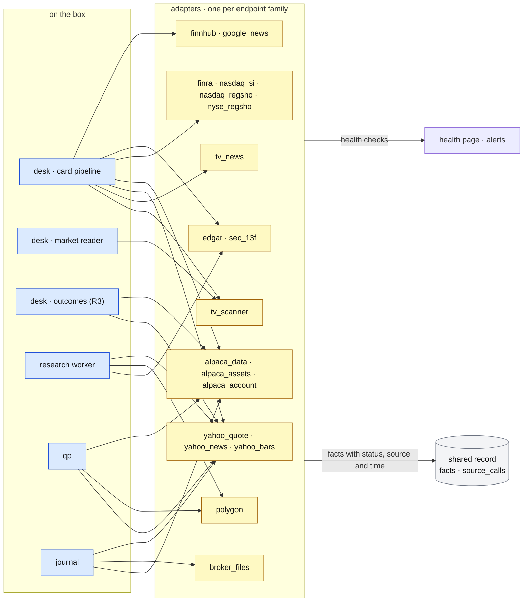

# Data sources

**Above:** [ARCHITECTURE.md](../../ARCHITECTURE.md) §2.8 (outside the box).

**Talks to:** every block that needs the outside world. Each one reaches it
through adapters:

| Block | Sources it uses |
|---|---|
| the [desk](../desk/DESK.md) | the scanner, quotes, short interest, borrow, news, index and sector quotes, outcome bars |
| the [research worker](../research/RESEARCH-WORKER.md) | EDGAR, 13F filings, Polygon, index bars |
| [qp](../quant/QUANT.md) | chart bars |
| the [journal](../journal/JOURNAL.md) | account fills, bars |

---

## 1. What it is

Every outside source the desk uses, and the **adapter** in front of each one.

**An adapter is the only code that talks to one endpoint family.** A provider
with several endpoints, such as Yahoo or Alpaca, has one adapter per endpoint
family. Each adapter keeps in one place everything about its source:
- how to ask;
- how fast it may be asked;
- how fresh its answers stay;
- how to read them;
- what "nothing" and "could not ask" mean;
- how its health is judged.

Every other block asks adapters for **facts**, and never calls a source
directly.

**What the adapters never do:**
- guess a missing value (a missing value is `unavailable`, with the reason);
- read a missing value as 0, as "no" or as bearish;
- let a second source overwrite the first;
- let a source's failure fail a card.

---

## 2. The diagram

---

## 3. Its parts

### 3.1 The adapter contract

| Each adapter states | Meaning |
|---|---|
| families | the fact families it can produce |
| request | endpoint, method, headers, timeout |
| auth | none, a key (named in the secret file), or a User-Agent |
| limits | requests per second or per day; batch size; time budget |
| freshness | how long a fact it produced stays fresh, per family |
| parse | turning the answer into fact values, with alignment and sanity checks |
| honest null | what `none` means (the source answered: nothing) and what `unavailable` means (could not ask), each with a reason |
| health | how its content is judged: ok, degraded, down, on a schedule |
| fixtures | recorded answers, including failures, for CI |

**Every call is counted.** Each fact family keeps a count of the requests it
received, the calls it actually made, its failures and its last error, per day
(`source_calls`). These counts decide whether sharing a family across tools
pays ([SHARED-RECORD.md](SHARED-RECORD.md)).

### 3.2 Every source

| Adapter | Endpoint(s) | Auth | Families | Quirks |
|---|---|---|---|---|
| **tv_scanner** | `POST scanner.tradingview.com/america/scan?label-product=screener-stock` | none; a browser User-Agent, Origin and Referer of tradingview.com; 15 s | candidates per screener; `quote` (32 columns, batches of 200); index and sector-ETF quotes | **ignores unknown columns silently**, so the column list is verified. A batch whose rows differ in length from the columns asked is refused (D-S3). It warns when two range windows are identical on most rows. `short_percentage_of_float` is never filled. Longer-window highs are not split-adjusted |
| **tv_news** | `news-headlines.tradingview.com/v2/headlines` | none | `news` | — |
| **yahoo_quote** | `quoteSummary` | cookie and crumb from `fc.yahoo.com` | `short_interest` (fallback) | per symbol |
| **yahoo_news** | `query1.finance.yahoo.com/v1/finance/search` | none | `news` | — |
| **yahoo_bars** | chart API (1-minute, daily), with or without extended hours | none | bars | shallow 1-minute history (weeks); years of daily |
| **alpaca_data** | `data.alpaca.markets/v2/stocks/bars`, `/v1beta1/news` | key | bars (fallback), `news` (Benzinga) | the free plan's IEX feed: thin volume, about a week of intraday history, regular hours only |
| **alpaca_assets** | the assets API | key | `borrow` (shortable, easy to borrow) | **as of now only**, with no history: a backtest applies today's flag and says so |
| **alpaca_account** | `GET /v2/account`, `GET /v2/account/activities/FILL` (paper or live) | each journal account's own key, read-only | journal fills; key test | at most 50 pages × 100 fills per fetch |
| **finra** | `cdn.finra.org/equity/regsho/monthly/shrt{date}.txt`, then the OTC biweekly paths | none | `short_interest` (shares short; the card works out the % of float) | **one file for every symbol**, fetched once a day; settlement twice a month |
| **nasdaq_si** | `api.nasdaq.com/api/quote/{t}/short-interest` | none | `short_interest` (fallback, two weeks of history) | per symbol |
| **nasdaq_regsho** | `nasdaqth{yyyymmdd}.txt` | none | `reg_sho` | per settlement day |
| **nyse_regsho** | the NYSE threshold-securities download | none | `reg_sho` | per settlement day |
| **edgar** | `data.sec.gov/api/xbrl/companyfacts/CIK{…}.json`; `www.sec.gov/files/company_tickers.json`; submissions (SIC, 8-K items); full-text search | a descriptive User-Agent (403 without it) | `oneil_c`, `oneil_a`, shares for `oneil_s`, `sic`, 8-K events, `news` | ten requests a second; the five EDGAR traps ([ONEIL.md](../research/ONEIL.md)); filings land weeks after the quarter's end |
| **sec_13f** | the SEC's quarterly Form 13F datasets | User-Agent | `oneil_i` | quarterly, 45 days after the quarter's end; managers over $100M only |
| **polygon** | grouped daily (the whole market); aggregates | key | `bars_universe`, bars | the free plan is end of day: no bars for today |
| **finnhub** | `finnhub.io/api/v1/company-news` | key | `news` | — |
| **google_news** | `news.google.com/rss/search` | none | `news` | asked only when the others return fewer than 2 items |
| **openfda**, **usaspending** | drug and device approvals; contract awards | none | N events (planned) | — |
| **broker_files** | uploaded TradingView, TTP and DXtrade files | — | journal fills | one parser per format, each with a sample file ([IMPORT.md](../journal/IMPORT.md)) |

### 3.3 Fallback orders

| Family | Order | Rule |
|---|---|---|
| `quote` | TradingView | a misaligned batch is refused; the last quote stays, with its age |
| `short_interest` | FINRA → Yahoo → Nasdaq | stop at the first plausible answer and record which source gave it. With no float, the % is of shares outstanding, and it says so |
| `borrow` | Alpaca | `unavailable` never means "not shortable" |
| `reg_sho` | Nasdaq + NYSE | both are asked; either listing counts |
| `news` | TradingView, Alpaca, Yahoo, EDGAR and Finnhub in parallel; Google when fewer than 2 items | the failing ones are named; the others still count |
| outcome bars | Yahoo → Alpaca | per ticker |
| chart bars | the chosen feed | never silently replaced ([FEEDS.md](../quant/FEEDS.md)) |
| index bars (M) | Yahoo | — |
| whole-market bars (RS) | Polygon | — |

**A second source for the same fact is stored beside the first,** with the
priority recorded. It never overwrites the first (the F-21 lesson).

### 3.4 Bars

**Every consumer gets the same shape:** the chart, strategies, backtests,
alerts, outcomes and the journal all receive a UTC time-indexed frame of open,
high, low, close and volume.

| Feed | Source | Strength | Weakness |
|---|---|---|---|
| `yahoo` | Yahoo | free, current, years of daily | shallow 1-minute history |
| `yahoo_ext` | Yahoo with pre- and after-market | one source, more hours | — |
| `polygon` | Polygon | deep history, extended hours, consolidated tape | free plan: no bars for today |
| `alpaca` | Alpaca IEX | live | thin IEX volume, short intraday history, regular hours |
| `hybrid` | Polygon history + Alpaca today | deep and today | **a volume seam**: IEX volume is a fraction of Polygon's, which distorts every VWAP on the Alpaca part |
| `hybrid_yahoo` | Polygon history + Yahoo today | deep and today, both consolidated | — |

**Where the feed detail lives:**
- choosing the feed, warm-up and the bar cache with its limits:
  [FEEDS.md](../quant/FEEDS.md);
- outcome bars, stored once per ticker per day and shared by every tool:
  [REGISTERS.md](../desk/tool/REGISTERS.md).

### 3.5 Health checks

The data check of the old desk asked each source for data that **cannot**
legitimately be empty, and judged the content, but only when a button was
pressed. In the design the same checks run **on a schedule**:
- each adapter at its own cadence;
- all of them before the open.

They feed the health page ([ALERTS.md](ALERTS.md)).

| Check | Down | Degraded |
|---|---|---|
| TradingView scanner: `close > 0`, 50 rows | zero rows; the first row has no usable price; the fetch failed | — |
| news: every source, for a liquid ticker | no stories from any | some sources failed, with the key named |
| Alpaca key: the account | rejected (401/403) | — |
| bar feeds: 40 daily bars each | the fetch failed; no data; under 15 rows; a close NaN or ≤ 0; every volume zero; the last bar over 5 sessions old; out of order or duplicated; a one-day move over 25 % | over 5 % of sessions without volume |
| indexes ^GSPC, ^IXIC | as bar feeds, with "M cannot be built" | — |
| **cross-source agreement**: the only check that catches a confidently wrong feed | the worst close difference over 0.5 % | under 3 shared sessions; fewer than 2 working feeds ("configure a second feed") |
| RS universe | no sessions; under 1,000 symbols | under 253 sessions |
| research facts | a required field missing | older than their clock allows, counted in trading sessions (M and groups: not from the last completed session; SIC: 14 days). The old check used 36 hours by the clock, which read every weekend as stale |
| EDGAR | the ticker map under 5,000; no quarters for a known filer; 403 | — |
| sector map | — | a card sector with no ETF mapping ([MARKET.md](../desk/MARKET.md)) |

**How checks are reported and run:**
- Each failing check carries its **fix**.
- Checks run **inside the programs' own environment**, so they never report a
  different set of keys from the one in use. The first live data check did.
- A red check sends an alert; amber shows on the page.

### 3.6 Keys

| Key | Used by |
|---|---|
| Alpaca (data) | `alpaca_data`, `alpaca_assets` |
| each journal account's Alpaca key | `alpaca_account`, per account |
| Polygon | `polygon` |
| Finnhub | `finnhub` |
| the EDGAR User-Agent | `edgar`, `sec_13f` |

**Where keys live, and what happens without one:**
- All keys are in the secret files ([BOX.md](../box/BOX.md) §4.3).
- A missing key makes its adapter `unavailable` with the reason "key not set",
  and the health page names it.
- Settings can set and test keys. The old Settings page had no inputs for them
  (D-T4).

---

## 4. Contracts

| It owns | Where |
|---|---|
| `source_calls`: requests, calls, failures, last error, per family and day | the shared record |
| `health_checks`: each check's result over time (to build) | the shared record |
| the bar cache | qp's caches on disk ([FEEDS.md](../quant/FEEDS.md)) |

**What it serves.** Facts to the desk, the research worker, qp and the journal,
through one interface:
- **the call:** `fetch(family, subjects, as_of?)`;
- **each fact returned:** its status, source and the instant it was learned.

---

## 5. When it fails

| Event | What happens |
|---|---|
| a source fails or times out | its families are `unavailable` with the reason; cards still build; the health check goes red and alerts with the fix |
| a source answers nonsense | the adapter's sanity checks refuse it; the cross-source check catches a plausible but wrong feed |
| TradingView changes or drops a column | the alignment check refuses the batch; the scan report says why; health goes red; no card gets shifted values |
| a free tier's limit is hit | the adapter stops at its limit and carries the rest; the limit is named on the health page |
| a key is missing or refused | the adapter is `unavailable · key not set` (or refused); nothing crashes |

---

## 6. Built on

**The old desk:**
- [DATA-PIPELINE](../../legacy/screeners/DATA-PIPELINE.md): every call the card
  pipeline makes, with endpoints and fallbacks;
- [DATA-FEEDS](../../legacy/qp/DATA-FEEDS.md): qp's bar feeds;
- [DATACHECK](../../legacy/screeners/DATACHECK.md): judging each source by its
  content;
- [CANSLIM](../../legacy/qp/CANSLIM.md) §3.1 and §10.4: the free official
  sources for O'Neil data;
- [ACCOUNTS](../../legacy/journal/ACCOUNTS.md): the journal's Alpaca calls.

**What failed there:**

| ID | Fault | Prevented by |
|---|---|---|
| — | the same ticker's facts fetched once per tool | facts fetched once, shared |
| D-S1 | short interest and borrow wiped on a re-quote | each family writes only itself |
| D-S2, F-14 | a missing value read as a number or as bearish | the honest null |
| D-S3 | a column shift misaligning every field | the alignment check |
| Q-N6 | routes with their own Polygon default | no per-route defaults |
| — | "alpaca ok" printed daily while the key was refused | health judged by content, on a schedule |
| — | the data check ran only when pressed, and once from the wrong environment | scheduled, inside the programs' environment |
| D-T4 | the fix lines point to a Settings section with no inputs | keys set and tested in Settings |
| — | a full disk from an unbounded bar cache | the cache's limits |

---

## 7. Status

| Part | Status |
|---|---|
| the calls themselves, their fallbacks and the alignment check | **built** (legacy, inside the pipeline's stages) |
| short interest, borrow and news through the fact store, with call counts | **built, in shadow** (step 5) |
| one adapter per source for every fetch, with fixtures | **partly**; the rest **to build** as each family moves (step D) |
| the scheduled health checks and the health page | **to build** (step E) |
| keys set and tested from Settings | **to build** |
