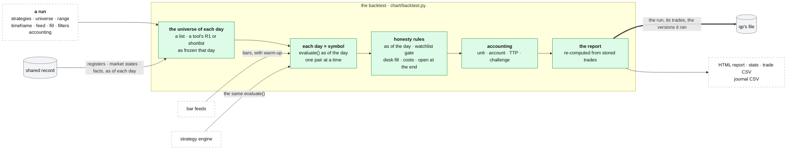

# The backtest

**Above:** [QUANT.md](QUANT.md) §3 (qp's parts).

**Talks to:**
- the [strategy engine](STRATEGIES.md): the same `evaluate()` as the preview;
- the [shared record](../outside/SHARED-RECORD.md): the registers, the market
  states and the facts, as of each day;
- the [bar feeds](FEEDS.md): the bars of each day;
- the [chart](CHART.md): its Backtest section, and each trade opened on the
  chart;
- the [journal](../journal/JOURNAL.md): a run exported as trades.

---

## 1. What it is

**If I had traded these rules on the stocks my tools found, on the days they
found them, what would have happened, honestly?**

For every trading day in the range, and every symbol in that day's universe,
the backtest calls **the same `strategy.evaluate()` the chart's preview
uses**, as of that day. There is no second evaluator, so the preview and the
backtest cannot disagree.

**What it never does:**
- trades a day with knowledge of a later one;
- counts a trade the scanner had not yet made possible;
- puts a still-open position into the win rate;
- picks a ranking metric for the trader: an unnamed one is an error;
- hides how much of the universe it could not evaluate.

---

## 2. The diagram

---

## 3. Its parts

### 3.1 A run

- **One run at a time**, because the box is small. A second start while one
  runs is refused, naming the running one.
- **Stoppable:** it stops at its next symbol.
- **Not tied to the page:** closing the page does not stop a run, and
  reopening it picks the run up. If qp restarts, the run is marked
  interrupted.
- **Sequential:** one (day, symbol) pair at a time; progress is the share of
  pairs done.
- **It records what it ran:** today a frozen copy of each strategy; with
  strategy versions, the versions ([STRATEGIES.md](STRATEGIES.md) §3.9). So
  editing a strategy later never changes what an old result means.

### 3.2 The universe

| `universe.kind` | Each day evaluates |
|---|---|
| `symbols` | the same fixed list every day |
| `register` | one tool's R1 or shortlist, **as that tool froze it that day** |
| `tools` | the registers of every tool assigned to the strategy (or named in the run), unioned; with two books (a long and a short strategy), their tools unioned too |

`extra_symbols` adds names to a register universe; their trades are marked
`_extra`, so "not on the register" stays visible.

**Where the registers come from.** Today, over HTTP from each tool's port,
and from the archive for a stopped tool. The design: **from the shared
record's copies, as of the day**, through the desk's `/db/<tool>` route, so a
stopped tool is just a tool ([SHARED-RECORD.md](../outside/SHARED-RECORD.md)
§3.4). Built, and off until past backtests re-run on it give identical trades
(`quantRegistersMode`, [MIGRATION.md](../MIGRATION.md) step D).

### 3.3 Honesty rules, all on by default

| Rule | What it prevents |
|---|---|
| **As of the day.** Each (day, symbol) is evaluated as of that day; only trades **entered that day** count. Warm-up days are context, never trades | look-ahead; warm-up signals counted twice |
| **The watchlist gate** (`scan_gate`): a trade taken **before the scanner had found the stock** is dropped. `scan_gate: false` shows the old numbers on purpose. No effect on a `symbols` universe | trades no alert could have fired |
| **The desk fill:** the next bar's open, levels from the decision close ([STRATEGIES.md](STRATEGIES.md) §3.6) | the optimistic `close` fill |
| **Costs:** `cost_bps` per side (spread, slippage, commission; a round trip pays twice), and per-share fees with a per-order minimum | "a backtest without costs lies" |
| **Open at the end:** a position still open when its window ends is recorded as `open` with its unrealised return, **never in the win rate** | flattering win rates |
| **Coverage, stated:** the pairs evaluated, those whose feed returned no bars, the pairs per tool, how many each filter removed | a thin feed, or one dominant tool, passing for a strategy that rarely fires |

### 3.4 What to test

| Setting | Means | Default |
|---|---|---|
| `strategy_id`, `strategy`, `strategies` | one strategy, or two books (long and short) | — |
| `universe` | §3.2 | a tool's R1 |
| `start`, `end` | the range | — |
| `tf` | the bar timeframe: 1m, 2m, 5m, 15m, 30m, 1h, 1d | 5m |
| `feed` | the bar feed ([FEEDS.md](FEEDS.md)) | qp's default feed (today some routes still name Polygon: Q-N6) |
| `view` | `all` (extended hours) or `regular` | all |
| `fill` | the strategy's own fill, or another for comparison | the strategy's (`desk`) |
| `days` | warm-up sessions before each day, extended as the strategy needs | 3 |
| `rules` | the session rules: regular-hours entries, end-of-day close, entries per day | none |

### 3.5 Filters and caps, by choice

| Setting | Does |
|---|---|
| `min_rvol` | the In-Play filter: a pair is evaluated only if its relative volume, **measured by qp at the strategy's window start**, is above this; below and unverifiable are counted apart |
| `canslim` | a gate on the CANSLIM letters **as known that day**. A rule naming a letter that cannot be rebuilt for a past day is refused before the run starts; blocked and unverifiable pairs are counted. Today in the API only (Q-N4). **The design:** a control on the page, reading the research worker's facts as of the day, M included from the market history as it was |
| `check_shortable` | drops shorts the broker would not lend (Alpaca). Alpaca keeps no borrow history, so **today's** flag is applied to a past day, and the report says so; a name it cannot answer for is kept and named |
| `rank_per_day` with a metric | keep the best N signals a day: `vwap_extension` (decision price to stop, largest first: right only for a VWAP-anchored stop), `tight_stop` (smallest first), `reg_score` (the register's score), `rvol` (qp's RVOL at the window start). **No default:** an unnamed or unknown metric is an error, because the wrong one silently reshapes the strategy (backtest #231 lost 103 of 117 signals to it) |
| the desk's caps | one entry per stock per day; a whole-run trades-per-day cap, in the order the signals fired |

`chart/rank_sweep.py` runs the same selection over a finished run's trades with
every metric, to measure which suits a strategy.

### 3.6 Money: one accounting

| Block | Inputs | Answers |
|---|---|---|
| **unit** | none | per-trade % returns |
| **account** | `account_equity` (100,000 on the page), `risk_pct` (0.5) **or** `risk_usd`, `max_position_pct`, `max_leverage` (1 = cash), `size_ratio`, `max_order_value`, `min_shares` | real money: shares from the stop, so every stop-out loses the same %; equity **compounds** in trade order; a trade with no usable stop is **excluded and counted**, never sized at 1 share; a trade the buying power could not take is skipped and counted |
| **TTP** (prop firm, Trade The Pool's defaults) | `fee_per_share`, `fee_min` per order, `shares` (fixed, 100), `min_profit_ps` | dollar P&L for a fixed size; the **minimum-profit rule**: a winner under `min_profit_ps` dollars a share does not count toward the target (losses always count), tested on the position's average over all its fills; every fill pays its own order fee |
| **challenge** (on an account run) | `{target_pct, max_dd_pct, basis: start or peak}` | did the account reach the target **before** it touched the drawdown limit? Also a worst case in which every open position stops out at once, because a closed-trade curve cannot see a position that dipped and came back |

### 3.7 The report

Computed afterwards from the stored trades (`report.py`), so it can be re-run on
any past backtest. It says whether its numbers are **dollars** (an account run)
or **unit %**.

| Section | Numbers |
|---|---|
| headline | trades, wins, losses, breakeven (exactly 0 is not a win), win rate, gross profit and loss, net profit, **profit factor** (none without a losing trade, never ∞), expectancy, average win and loss, payoff ratio, largest win and loss |
| R-multiples | total, average, best, worst, the distribution in buckets. **R reads from net,** the same money as the net profit; the gross total beside it |
| holding time | average, longest, shortest, winners against losers, total time in positions |
| splits | by side, by exit reason, by symbol, by day |
| equity and risk | the curve marked at **exit**; maximum drawdown in $ and %, its length; streaks |
| ratios | Sharpe, Sortino, Calmar from daily returns over **every session in the range**, flat days included; annualised, and flagged as extrapolation on short samples |
| exposure | the share of regular-hours minutes in a position |
| sample adequacy | each warning, as a fact with its reason |
| the borrow check | says when "check shortable" was ticked and nothing was answered (backtest #355) |
| prop-firm detail | counted against wasted profit under the minimum-profit rule |

**On the page,** each trade opens its symbol and day on the chart with the run's
own timeframe, feed, fill and strategy. A filter (`=`, `≠`, `>`, `<`, `in`,
`has`; times as `hhmm`, `dur_min`, `dow`) narrows the trades and the filtered
CSV.

---

## 4. Contracts

| It owns (qp's file) | Key |
|---|---|
| `backtests` (the run, its spec, its status, the strategies or versions it ran, its summary) | id |
| `backtest_trades` | run, trade |

| It reads | From |
|---|---|
| R1, the shortlist, R3, as of a day | the shared record, through the desk's `/db/<tool>` (today: each tool's port) |
| the market state and the CANSLIM facts as of a day | the shared record (**to build**) |
| bars | the feeds |

| Route (behind `/quant/`) | Does |
|---|---|
| `POST /api/backtest` | start a run (refused while one runs) |
| `GET /api/backtest/{bid}` | status, progress, summary, trades |
| `GET /api/backtests` | every run, newest first (`brief=1` for the headlines) |
| `POST /api/backtest/{bid}/stop`; `DELETE /api/backtest/{bid}` | stop; delete with its trades |
| `GET /api/backtest/{bid}/report` | the HTML report, phone-readable |
| `GET /api/backtest/{bid}/stats.json` | every number of the report |
| `GET /api/backtest/{bid}/csv` | every trade with every register column of its card (`ctx_*`) |
| `GET /api/backtest/{bid}/journal.csv` | one row per trade, for the journal ([IMPORT.md](../journal/IMPORT.md)) |

---

## 5. When it fails

| Event | What happens |
|---|---|
| a feed returns no bars for a pair | the pair is counted in the coverage line, by feed and tool |
| a register day cannot be read | the run says which tool and day, and does not count the day as empty |
| a CANSLIM letter cannot be rebuilt for a past day | the run is refused before it starts, naming the letter |
| qp restarts during a run | the run is marked interrupted; its trades so far are kept |
| the shared record is down | a run that needs registers or facts says so and does not start; a `symbols` run still works |

---

## 6. Built on

**The old desk:** [legacy/qp/BACKTEST.md](../../legacy/qp/BACKTEST.md), written
from `chart/backtest.py`, `report.py`, `rank_sweep.py`, `store.py` and the
Backtest section of the page.

**What failed there:**

| ID | Fault | Prevented by |
|---|---|---|
| Q-N4 | the CANSLIM gate had no control on the page | a control, reading the facts as of the day |
| Q-N6 | the backtest's feed defaulted to Polygon, not the desk's default | no per-route defaults ([FEEDS.md](FEEDS.md)) |
| — | registers were read over HTTP from every tool's port; a stopped tool needed the archive | the shared record's copies |
| — | a run froze a copy of each strategy, with no version | strategy versions |

---

## 7. Status

| Part | Status |
|---|---|
| the run, the universes, the honesty rules, the settings, the accounting, the report, the exports | **built** (legacy, kept) |
| registers from the shared record | **built, off** (`quantRegistersMode`); on after a re-run of past backtests gives identical trades (step D) |
| facts and market states as of a day; the CANSLIM control on the page | **to build** (step D) |
| every route on qp's default feed | **to build** (Q-N6) |
| strategy versions recorded by each run | **to build** |

**How it is proven:**
1. **Backtest parity.** A set of past backtests re-run on the shared record
   gives the same trades and numbers, with the same strategies and universes.
2. **CANSLIM gate.** A gated backtest reads the same letters the cards showed
   that day.
