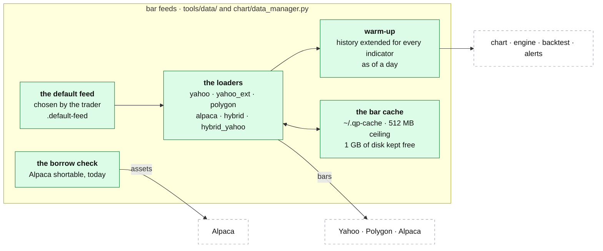

# Bar feeds and the cache

**Above:** [QUANT.md](QUANT.md) §3 (qp's parts), and
[SOURCES.md](../outside/SOURCES.md) §3.4, which lists every bar source.

**Talks to:**
- every part of qp that needs bars: the [chart](CHART.md), the
  [library](LIBRARY.md)'s compare tool, the [strategy engine](STRATEGIES.md),
  the [backtest](BACKTEST.md), the [signal alerts](SIGNAL-ALERTS.md);
- Yahoo, Polygon and Alpaca, the sources behind the feeds;
- the box's disk, which the cache must never fill.

---

## 1. What it is

**One place for bars in qp.** Every part of qp fetches through the same
loaders, each returning the same shape: a time-zone-aware (UTC) frame of open,
high, low, close and volume. The trader chooses the default feed; the loaders
extend history for warm-up, keep a cache on disk within limits, and say which
feeds actually answer.

It also holds **the borrow check:** will the broker let this account short the
name?

**What it never does:**
- infers the default feed from a key being present: a key is not a working
  plan;
- lets the cache fill the disk;
- turns a borrow check that could not be answered into a refusal.

---

## 2. The diagram

---

## 3. Its parts

### 3.1 The feeds

| Feed | Source | Strength | Weakness |
|---|---|---|---|
| `yahoo` | Yahoo Finance | free, current, years of daily history | shallow 1-minute history |
| `yahoo_ext` | Yahoo with its own pre-market and after-hours | one source, more hours: for strategies that read pre-market levels | — |
| `polygon` | Polygon.io | deep history, full extended hours, consolidated tape | the free plan is end of day: no bars for today |
| `alpaca` | Alpaca IEX | live | IEX only: thin volume, about a week of intraday history, regular hours |
| `hybrid` | Polygon's history, Alpaca for today | deep history and today | **a volume seam:** IEX volume is a fraction of Polygon's, which distorts every VWAP on the Alpaca part |
| `hybrid_yahoo` | Polygon's history, Yahoo for today | deep history and today, both consolidated | — |

**Keys** come from the environment or `quant-platform/.env`. The deploy copies
the desk's Alpaca pair there from the desk's keys (`scripts/sync-qp-env.js`), so
qp and the desk never hold different keys. `POLYGON_API_KEY` is optional.

### 3.2 The default feed

- **Chosen by hand,** on qp's page (More → Feed → *make default*), saved in
  `quant-platform/.default-feed`, and used by every chart, backtest and alert
  cycle that names no feed. Without a choice it is `yahoo`.
- **Never inferred.** It used to be Polygon whenever a key existed; a key
  present did not mean its plan covered the data, and every 1-minute request
  was refused while qp called Polygon its best feed.
- **No route has a default of its own.** Today some routes still name Polygon
  when no feed is passed (`/api/chart`, `/api/strategy/explain`, the print
  sheets, the backtest); the page always passes one (Q-N6). The design: every
  route uses the default feed.

### 3.3 Warm-up, the live tail, and as of a day

- **Warm-up:** the fetch window is extended so every indicator on the chart or
  in the strategy has enough history before the first bar shown
  (`required_days`). No juggling of days by hand.
- **The live tail:** with **▶ Live**, qp recomputes on an interval and pushes
  only the newest bar and each indicator's newest value over `/ws/live`.
- **As of a day:** `asof` hides every bar after that date, for replays and for
  the backtest.
- **Bars per alert cycle:** each symbol's bars are fetched once per cycle and
  shared by every strategy (to build, [SIGNAL-ALERTS.md](SIGNAL-ALERTS.md)).

### 3.4 Which feeds actually answer

| Check | Asks | Use |
|---|---|---|
| `GET /api/health` | which feeds have credentials | an inventory only: a present key is not a working one |
| `GET /api/feedcheck` | one small real fetch per feed, judged by the data check's rules | the deploy prints it. It replaced a line that said "alpaca ok" every day while the key was refused with a 401. It never raises and never answers 4xx: its caller is a deploy script |
| `GET /api/datacheck` | every loader, both indexes, agreement across sources, the RS universe, EDGAR | the full, slow answer, by hand ([legacy/screeners/DATACHECK.md](../../legacy/screeners/DATACHECK.md)) |

The scheduled source checks of the desk ([SOURCES.md](../outside/SOURCES.md)
§3.5) include the bar feeds, so a feed that stops answering turns the health
page red without anyone pressing a button.

### 3.5 The bar cache

Bars are cached as Parquet files under `~/.qp-cache/` (`QP_CACHE_DIR`), per
feed: Polygon's files are prefixed, so feeds never mix.

**Why it has limits.** Nothing used to delete a cached file. A print sheet is
up to 150 charts, each a multi-day 1-minute frame; a few afternoons of printing
is gigabytes, and the day the disk filled, qp and every program on the box
stopped.

| Trigger | Action |
|---|---|
| the cache is over its ceiling (`QP_CACHE_MAX_MB`, default **512 MB**) | trim the oldest files to 70 % of the ceiling |
| the disk has less than `QP_CACHE_MIN_FREE_MB` free (default **1024 MB**) | trim hard, whatever the cache's size |

It trims where it grows: every loader calls the sweeper after writing. The
cache is rebuildable, so it is never backed up ([BACKUPS.md](../outside/BACKUPS.md)).

The research worker's caches (the grouped daily bars, the SIC map, 13F, EDGAR's
company facts) live beside it and are described with the worker
([ONEIL.md](../research/ONEIL.md)).

### 3.6 The borrow check

**Will the broker let this account short the name?** Backtest #354 made
+$1,345 over twelve trades; one short (XE) made +$1,409 of it, and Alpaca
answers that XE cannot be sold short. Without it the run lost $63. Most of what
the screeners find is a small cap with no borrow, so for a short book this is
the common case.

- Alpaca reports `shortable` **as it is now**; there is no history. A backtest
  applies **today's** flag to a past day and says so.
- **An unanswerable check is not a refusal:** if Alpaca cannot be reached, the
  answer is "unchecked" and the trade stands. Dropping trades over a timeout
  would turn a network blip into a strategy result.
- The backtest report says when the check was asked for and nothing was
  answered ([BACKTEST.md](BACKTEST.md)).

The card's borrow facts are the desk's, fetched through its Alpaca adapter
([CARD.md](../desk/tool/CARD.md)); this check is qp's own, for backtests.

---

## 4. Contracts

| It owns | Where |
|---|---|
| the default feed | `quant-platform/.default-feed` |
| the bar cache | `~/.qp-cache/`, rebuildable |

| Route (behind `/quant/`) | Does |
|---|---|
| `POST /api/settings/default-feed` | set the default feed |
| `GET /api/health`, `GET /api/feedcheck`, `GET /api/datacheck` | §3.4 |
| `GET /api/cache`, `POST /api/cache/clear`, `POST /api/cache/sweep` | the cache's size and free disk; clear (all, or older than N days); trim now |
| `WS /ws/live` | the live tail |

---

## 5. When it fails

| Event | What happens |
|---|---|
| a feed refuses or returns nothing | the caller says which feed and which symbols; a backtest counts the empty pairs in its coverage line; the source check turns red |
| the disk runs low | the cache trims hard before anything else fills it |
| Alpaca cannot answer the borrow check | "unchecked"; the trade stands; the report says so |
| the default feed's plan stops covering the data | the feed check fails at the deploy and on the health page; the trader picks another default |

---

## 6. Built on

**The old desk:** [legacy/qp/DATA-FEEDS.md](../../legacy/qp/DATA-FEEDS.md),
written from `chart/data_manager.py`, `tools/data/*.py` and the feed routes.

**What failed there:**

| ID | Fault | Prevented by |
|---|---|---|
| Q-N6 | some routes default to Polygon | every route on the default feed |
| — | the default feed was inferred from a key | chosen by hand |
| — | the cache filled the disk and stopped every program | a ceiling, and a free-disk floor |
| — | "alpaca ok" printed while the key was refused | the feed check fetches and judges |

---

## 7. Status

| Part | Status |
|---|---|
| the loaders, the chosen default, warm-up, the live tail, the cache's limits, the feed check, the borrow check | **built** (legacy, kept) |
| every route on the default feed | **to build** (Q-N6) |
| bars once per symbol per alert cycle | **to build** |
| the feeds in the desk's scheduled source checks | **to build** (step E) |
