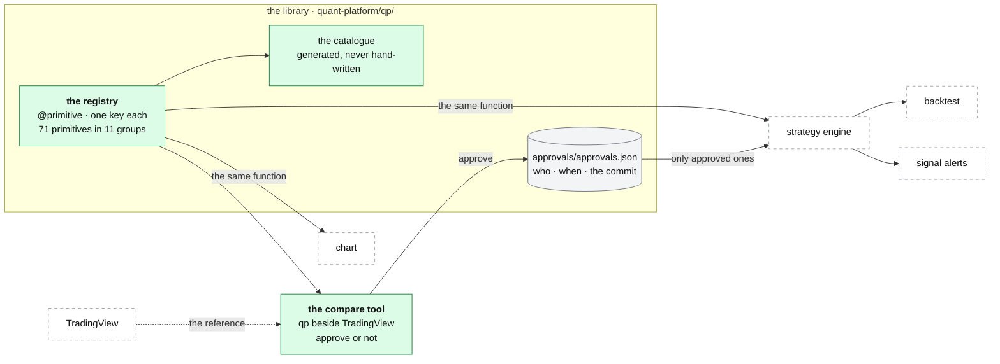

# The library: verified market math

**Above:** [QUANT.md](QUANT.md) §3 (qp's parts).

**Talks to:**
- the [strategy engine](STRATEGIES.md), the [backtest](BACKTEST.md), the
  [signal alerts](SIGNAL-ALERTS.md) and the [chart](CHART.md): every one of them
  calls the same functions;
- the [bar feeds](FEEDS.md), whose bars it computes on;
- TradingView, against which a person verifies each primitive.

---

## 1. What it is

**The only market math in qp.** Every indicator is a registered function, a
**primitive**, in one registry. The chart, the strategy engine, the backtest,
the alerts and the print sheets all reach the same function through the same
registry, so **what was verified against TradingView is what the chart draws
and the backtest trades.**

A primitive is **trusted only once a person has compared it with TradingView
and approved it.** The approval is recorded with who, when and the commit of
the code approved.

**Its scope.** The rule covers qp. Two other places compute market numbers, each
verified in its own way:
- the O'Neil math (RS, distribution days, bases, groups) is the research
  worker's, checked against O'Neil's published rules and by hand on charts
  ([ONEIL.md](../research/ONEIL.md));
- the desk's market read and card numbers use TradingView's own columns
  ([MARKET.md](../desk/MARKET.md), [CARD.md](../desk/tool/CARD.md)).

**What it never does:**
- lets an unapproved primitive be used by a strategy;
- shows zero where a value is not known: NaN means "not known yet";
- lets two primitives share a short name, which a strategy could silently swap;
- has its catalogue written by hand.

---

## 2. The diagram



---

## 3. Its parts

### 3.1 What is in it: 71 primitives, all approved

| Group | Count | Primitives |
|---|---|---|
| `ma` | 7 | sma, ema, wma, rma, vwma, hma, pine_5day (Pine's 5-day MA on 1-minute data) |
| `vwap` | 16 | session, nday_block, nday_rolling, weekly, monthly, anchored, today_hh/ll, week_hh/ll, swing_hh/ll, last_hour_hh/ll, gap, stdev_bands |
| `volatility` | 6 | true_range, atr, atr_daily, stdev, bb, bb_ema |
| `osc` | 1 | rsi |
| `extremes` | 2 | highest, lowest |
| `levels` | 29 | day_open, prev_day_open/high/low/close, today_high/low, today_vol_max, pm_high/low, postmarket_high/low, postpre_high/low, weekly_open/high/low, prev_week_open, monthly_open/high/low, prev_month_open, monday_high/low, yearly_open, prev_year_open, window_high/low, dynamic_sr |
| `structure` | 2 | pivot_high, pivot_low |
| `pivots` | 1 | floor (P, R1–R3, S1–S3) |
| `candle` | 4 | body, upper_wick, lower_wick, bar_range |
| `trend` | 1 | slope |
| `volume` | 2 | avg_volume, rel_volume (RVOL) |

Each primitive's inputs, outputs and parameters:
[legacy/qp/CATALOG.md](../../legacy/qp/CATALOG.md), generated from the registry.

**Derived quantities are not primitives.** A body as a % of the range, a move in
ATR, a distance to R1: these are composed in a strategy with an `expr` operand
([STRATEGIES.md](STRATEGIES.md)).

### 3.2 How a primitive is defined

```python
from qp.registry import primitive, Param

@primitive(
    name='sma',                    # short name, unique across the whole library
    group='ma',                    # the key becomes 'ma.sma'
    description='Simple moving average of `source` over `length` bars.',
    params=(Param('length', 'int', default=9, min=1),),
    inputs=('source',),            # or ('bars',)
    # outputs=('upper', 'middle', 'lower') when it returns several lines
    # compute_tf='1m' when it is defined on a fixed timeframe
)
def sma(source, length): ...
```

| Part | Means |
|---|---|
| `inputs=('source',)` | one array: close, open, high, low, hl2, hlc3, ohlc4, volume, body_high, body_low |
| `inputs=('bars',)` | a `qp.Bars`: a validated OHLCV frame (time-zone aware, increasing, no duplicates) |
| `outputs` | `('value',)` returns one array aligned to the bars; several names return a dict of arrays |
| `Param` | name, kind (`int`, `float`, `str`, `bool`), default, min, max, description |
| `compute_tf` | the primitive needs bars of this timeframe whatever the chart shows (for example `pine_5day` on 1-minute bars); the caller maps the result back |

**NaN marks the bars where a value is not known:** warm-up, outside the session,
before an anchor, a level not yet known. The decorator refuses a duplicate key
and a duplicate short name.

### 3.3 Verification against TradingView

1. Run the compare tool on the box, on its own port, through an SSH tunnel
   (`tools/compare_server.py --port 8767`, bound to `127.0.0.1`).
2. Pick a primitive (🚧 draft, ✅ approved); set the symbol, timeframe, days,
   source and parameters; **Compute**.
3. Compare qp's chart with the TradingView widget beside it, with the matching
   TradingView study where one exists: the shape, and the values on two or
   three bars.
4. **Match:** *Approve as verified*. This writes `approvals/approvals.json`:
   who, when, the git commit of the code approved, notes. **Mismatch:** do not
   approve; record the primitive, the settings and what differs.
5. Commit `approvals.json`. Re-approving after a fix overwrites the record, so
   it points at the fixed code.

The compare tool loads bars from every feed qp knows ([FEEDS.md](FEEDS.md)).
Verify VWAPs on Polygon on a completed day: the Alpaca IEX seam distorts volume.

### 3.4 Adding a primitive

1. Write it in a group file under `qp/primitives/`; a new file is found
   automatically.
2. Restart the compare tool: it appears as 🚧.
3. Verify and approve; regenerate the catalogue with `tools/gen_catalog.py`;
   commit.

### 3.5 Deliberate differences from the source Pine scripts

Everything else matches bar for bar.

1. **VWAPs default to regular hours** (`rth_only=True`), as a standard
   TradingView equities chart does; `rth_only=False` accumulates extended
   hours.
2. **Two N-session VWAPs:** `vwap.nday_block` is Pine's block-reset study
   (`anchor_offset` lines its phase up with TradingView); `vwap.nday_rolling`
   is a trailing VWAP always anchored N−1 sessions back.
3. **`last_hour_*` stops at 16:00:** the raw Pine leaks into after-hours on
   extended charts.
4. **`pivots.floor` defaults to regular-hours sessions,** as TradingView's
   daily stock bars do; `'eth'` gives the literal full-day behaviour.
5. **Before a VWAP's first anchor nothing is shown,** where Pine shows a line
   that depends on how many bars happen to be loaded.
6. **Weekly, monthly and yearly levels are regular-hours only;** `weekly_open`
   is Monday 09:30, not the 04:00 pre-market print.
7. **On daily charts** each daily bar is treated as the regular-hours
   aggregate, so levels, pivots and session VWAPs work on 1-day frames.

---

## 4. Contracts

| It owns | Where |
|---|---|
| the primitives | `quant-platform/qp/primitives/`, in git |
| the approvals | `quant-platform/approvals/approvals.json`, in git |
| the catalogue | generated by `tools/gen_catalog.py` |

| It is used through | |
|---|---|
| `qp.REGISTRY['<group>.<name>'].fn(...)` | every caller |
| `qp.approved_primitives()` | the slice a strategy may use |

| The compare tool's routes (its own port, on the box only) | |
|---|---|
| `GET /api/health`, `GET /api/primitives`, `GET /api/data`, `POST /api/approve` | |

---

## 5. When it fails

| Event | What happens |
|---|---|
| a primitive is not approved | a strategy that names it is refused; the chart shows it marked 🚧 |
| a fix changes an approved primitive | it must be approved again; the approval names the commit, so a stale approval is visible |
| a feed gives bars with gaps or duplicates | `qp.Bars` refuses them, with the reason |
| a value cannot be known for a bar | NaN, and every rule on it is false ([STRATEGIES.md](STRATEGIES.md)) |

---

## 6. Built on

**The old desk:** [legacy/qp/LIBRARY.md](../../legacy/qp/LIBRARY.md),
[legacy/qp/CATALOG.md](../../legacy/qp/CATALOG.md), and the code itself, copied
in [legacy/qp/library/](../../legacy/qp/library/README.md) so a rebuild can
start from verified math.

**Why it is kept as it is.** It is the one part of qp built the way the whole
desk should be: one implementation, one registry, a human verification step
with a recorded approval, a generated catalogue that cannot drift, and stated
differences.

---

## 7. Status

| Part | Status |
|---|---|
| the registry, the 71 primitives, all approved; the compare tool; the generated catalogue | **built** (legacy, kept) |
| qp's tests (`run_all`) in CI on every pull request | **built** (step 1) |
