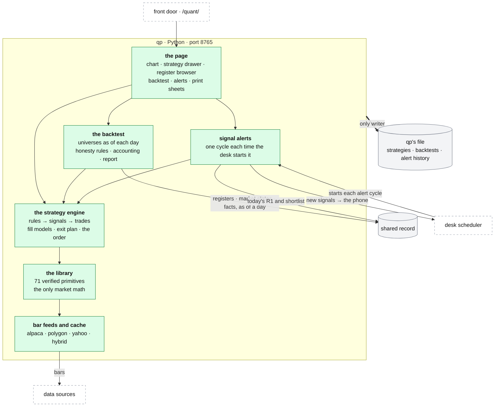

# qp: charts, strategies, backtests, alerts

**Above:** [ARCHITECTURE.md](../../ARCHITECTURE.md) §4.4.

**Talks to:**
- the [front door](../front-door/FRONT-DOOR.md) (`/quant/`);
- the [shared record](../outside/SHARED-RECORD.md): registers, market states
  and facts, as of a day;
- the [data sources](../outside/SOURCES.md): bars;
- the [desk](../desk/DESK.md): its scheduler starts each alert cycle;
- the [journal](../journal/JOURNAL.md): the chart of a trade, and backtests
  exported as trades;
- its own [files](../files/FILES.md).

---

## 1. What it is

qp is the chart and backtest program of the desk, written in Python (FastAPI,
`quant-platform/chart/server.py`, port 8765). It is the best-built part of the
old desk, and its library, engine and backtest carry over almost unchanged.

| Job | The question it answers |
|---|---|
| **Chart** | what does this stock look like, with indicators I can trust? |
| **Build** | can I describe this setup as rules, by clicking? |
| **Backtest** | if I had traded these rules on the stocks my tools found, on the days they found them, what would have happened, honestly? |
| **Alert** | is one of my saved strategies firing now on today's lists? |
| **Print** | let me review a day's (or a list's) charts, with the numbers behind them |

**What it owns:**
- strategies and their versions;
- backtests and their trades;
- the alert history;
- the library's approvals.

**What it never does:**
- compute a card fact or a market fact;
- keep a timer of its own;
- place an order: it alerts only.

---

## 2. The diagram

---

## 3. Its parts

| Part | Job | Detail |
|---|---|---|
| **the page** | one page: chart, tools rail, indicators, the ⚡ strategy drawer (evaluate, test any rule, the signal funnel), the register browser, the backtest, alerts, print sheets | [CHART.md](CHART.md) |
| **the library** | the 71 verified primitives: the only market math anywhere in qp, each approved against TradingView | [LIBRARY.md](LIBRARY.md) |
| **the strategy engine** | the strategy grammar, 14 operators, timing and groups; entries and exits; the risk block; the four fill models; the exit plan and the one order function | [STRATEGIES.md](STRATEGIES.md) |
| **the backtest** | the same evaluation as the preview, day by day over a universe as frozen that day; the honesty rules; settings and filters; accounting; the report and exports | [BACKTEST.md](BACKTEST.md) |
| **signal alerts** | every saved strategy on today's lists, one cycle each time the desk starts it; one alert per strategy, symbol and bar; history kept; the cycle's new signals returned to the desk, which pushes them to the phone | [SIGNAL-ALERTS.md](SIGNAL-ALERTS.md) |
| **bar feeds and cache** | the feeds (Alpaca, Polygon, Yahoo, the hybrid), warm-up, the bar cache and its limits, the borrow check | [FEEDS.md](FEEDS.md) |

**The working rule of the page:** never trust a piece you have not seen.
Plot it, test it, then compose it.

---

## 4. What changes from today

| Change | Why | Detail |
|---|---|---|
| **One fill model for preview, backtest and alerts.** Alerts evaluate with the strategy's own fill (default `desk`) | an alert and a backtest of the same strategy must take the same bar (Q-N9) | [SIGNAL-ALERTS.md](SIGNAL-ALERTS.md) |
| **Registers, market states and facts are read as of a day from the shared record** | today they are read over HTTP from each tool's port, and a stopped tool needed the archive program | [BACKTEST.md](BACKTEST.md) |
| **No O'Neil computation** | the research worker owns it. While qp was down, every ticker first seen had a blank CANSLIM reading, and a photo then froze the blanks | [RESEARCH-WORKER.md](../research/RESEARCH-WORKER.md) |
| **No timer of its own** | the desk's scheduler starts each alert cycle and records it, so a cycle that fails or does not run alerts | [JOBS.md](../desk/JOBS.md) |
| **Alert history kept** | a restart never repeats an alert, and alerts can be reviewed | [SIGNAL-ALERTS.md](SIGNAL-ALERTS.md) |
| **Signals on the phone** | today a signal reaches only an open page (a sound and a browser notification). The desk pushes each new one to its own ntfy topic; qp holds no push key | [ALERTS.md](../outside/ALERTS.md) §3.6 |
| **Shared bars per cycle** | one fetch per symbol per cycle, shared by every strategy | [FEEDS.md](FEEDS.md) |
| **The CANSLIM gate on the page** | it is in the API only today (Q-N4); letters that cannot be rebuilt for a day are refused before the run | [BACKTEST.md](BACKTEST.md) |
| **`breakeven_after_target` simulated, or refused on save** | it is reported and never simulated today (Q-N7) | [STRATEGIES.md](STRATEGIES.md) |
| **Strategy versions** | saving a strategy creates a version; a backtest records the versions it ran. The versions live in qp's own file | [STRATEGIES.md](STRATEGIES.md) |
| **No per-route feed defaults** | some routes default to Polygon, not the desk's default (Q-N6) | [FEEDS.md](FEEDS.md) |

---

## 5. Contracts

| It owns (qp's file, `~/.qp/platform.db`) | Key |
|---|---|
| `strategies`, `strategy_versions` (versions: to build) | id; id, version |
| `backtests`, `backtest_trades` | id |
| `alert_seen`, `alert_history` | strategy, symbol, bar |
| the library's approvals | `approvals/approvals.json`, in git |

| It reads | From |
|---|---|
| bars | the data sources, through its feeds ([FEEDS.md](FEEDS.md)) |
| R1, the shortlist, R3, as of a day | the shared record (today: each tool's port; built but off: the desk's `/db/<tool>`) |
| market states, CANSLIM facts, as of a day | the shared record |

| Routes, behind `/quant/` | |
|---|---|
| the legacy routes carry over | 53 routes and the live WebSocket ([legacy/qp/API.md](../../legacy/qp/API.md)). The register routes read the shared record, and the alert routes read the stored history |
| `POST /api/alerts/cycle` (to build) | one alert cycle, started by the desk's scheduler; answers with the signals new in that cycle |

---

## 6. When it fails

| Event | What happens |
|---|---|
| qp is down | the desk is unaffected. Each alert cycle the scheduler starts fails, is recorded and alerts. Charts and backtests wait for qp to restart |
| a feed fails or returns nothing | the chart and the backtest say which feed and for which symbols; the backtest's coverage line counts the empty feeds |
| the shared record is down | backtests that need registers or facts say so and do not run; charts still work |
| one strategy or symbol fails in an alert cycle | the cycle goes on with the others; the error is in the cycle's record |

---

## 7. Built on

**The old desk:** the whole of [legacy/qp/](../../legacy/qp/README.md):
- [LIBRARY](../../legacy/qp/LIBRARY.md) and [CATALOG](../../legacy/qp/CATALOG.md),
  with the library's code in [library/](../../legacy/qp/library/README.md);
- [STRATEGIES](../../legacy/qp/STRATEGIES.md) and
  [BACKTEST](../../legacy/qp/BACKTEST.md);
- [ALERTS-AND-PRINTS](../../legacy/qp/ALERTS-AND-PRINTS.md) and
  [PAGE](../../legacy/qp/PAGE.md);
- [DATA-FEEDS](../../legacy/qp/DATA-FEEDS.md);
- [SCALPS](../../legacy/qp/SCALPS.md), [SCALPS_SPEC](../../legacy/qp/SCALPS_SPEC.md)
  and [PINE](../../legacy/qp/PINE.md);
- [OPERATIONS](../../legacy/qp/OPERATIONS.md) and
  [DATA-MODEL](../../legacy/qp/DATA-MODEL.md).

**What failed there:**

| ID | Fault | Prevented by |
|---|---|---|
| Q-N9 | alerts use the `close` fill and backtests `desk`, so an alert can fire on a different bar | one fill model |
| Q-N7 | `breakeven_after_target` is reported, never simulated | simulated, or refused on save |
| Q-N4 | the CANSLIM gate has no control on the page | a control, reading facts as of the day |
| Q-N6 | some routes default to Polygon | no per-route defaults |
| Q-N5 | the nightly O'Neil chain lives in qp, on a hand-installed timer | moved to the research worker, started by the desk |
| — | registers are read over HTTP from every tool's port | read from the shared record |
| — | a qp restart took 3 min 20 s | fixed on 2026-10-06; one supervisor |
| — | alert repeats were held in memory | alert history stored (built, step 12) |
| — | each strategy-symbol pair fetched its own bars every cycle | shared bars per cycle |
| Q-N1–Q-N3, Q-N8, Q-N10 | out-of-date help text | help generated from the definitions |

The full list: [legacy/qp/KNOWN-ISSUES.md](../../legacy/qp/KNOWN-ISSUES.md).

---

## 8. Status

| Part | Status |
|---|---|
| the library, engine, backtest, page, print sheets | **built** (legacy, kept) |
| alerts on each strategy's own fill model; alert history kept | **built, live** (step 12) |
| registers from the shared record | **built, off** (`quantRegistersMode`). Today qp reads each tool's port |
| facts and market states as of a day | **to build** (step D) |
| alert cycles started by the desk's scheduler, their new signals pushed to the phone | **to build** (step C). Today qp runs its own watcher thread, and signals reach only an open page |
| the O'Neil chain out of qp | **built** in the research worker, in shadow; the chain still runs from qp's timer until step C |
| strategy versions; the CANSLIM control; `breakeven_after_target` | **to build** |
| a re-run of past backtests against the shared record, compared | **to do**, before step D |
