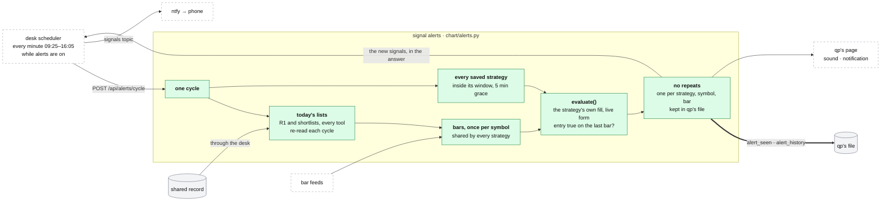

# Signal alerts

**Above:** [QUANT.md](QUANT.md) §3 (qp's parts).

**Talks to:**
- the desk's [scheduler](../desk/JOBS.md), which starts each cycle and pushes
  its new signals to the phone ([ALERTS.md](../outside/ALERTS.md) §3.6);
- the [strategy engine](STRATEGIES.md): the same `evaluate()`, with the
  strategy's own fill;
- the [shared record](../outside/SHARED-RECORD.md): today's R1 and shortlists of
  every tool, through the desk;
- the [bar feeds](FEEDS.md): today's 1-minute bars;
- the [chart](CHART.md): the alert list, the sound and the browser
  notification.

---

## 1. What it is

**Is one of my saved strategies firing now, on today's lists?** Each cycle
evaluates every saved strategy on every stock of today's R1 and shortlists,
and raises a signal when a strategy's entry holds on the last completed bar.

It **alerts only:** nothing is ordered.

**What it never does:**
- fires on a different bar from the one a backtest of the same strategy would
  enter on: it uses the strategy's own fill;
- alerts twice for one strategy, symbol and bar, even across a restart;
- lets one bad strategy or symbol stop a cycle;
- runs a timer of its own: each cycle is started by the desk.

---

## 2. The diagram

---

## 3. Its parts

### 3.1 A cycle

| Part | Rule |
|---|---|
| **when** | every minute, 09:25–16:05 New York on trading days, while alerts are on: started by the desk's job ([JOBS.md](../desk/JOBS.md) §3.5) |
| **the symbols** | the union of today's R1 and shortlists of every running tool, **re-read every cycle**: a stock found at 11:00 is watched from the next cycle |
| **the strategies** | every saved strategy, re-read every cycle: a strategy saved next week is watched with nothing to configure |
| **each strategy's window** | a strategy outside its own window (`window_start`–`window_end`, with 5 minutes' grace before the start, so the first signal in the window is not missed) is skipped |
| **the bars** | today's 1-minute bars from qp's default feed, **fetched once per symbol per cycle and shared by every strategy** (to build: today each strategy and symbol pair is its own fetch) |

### 3.2 The signal

`evaluate(strategy, symbol, 1m, days=1, fill=<the live form of the strategy's
fill>)` with `entry_now`: the entry group holds on the last completed bar.

- **The strategy's own fill** (default `desk`), in its live form: `desk` and
  `next_open` are evaluated as `live`, the same decision without the bar that
  has not printed yet; `close` stays `close` ([STRATEGIES.md](STRATEGIES.md)
  §3.6). So an alert and a backtest of the same strategy take the same bar,
  the same VWAP and the same ATR (Q-N9, fixed in step 12).
- THEN sequences are true on the bar that completes them, so a signal is close
  to an edge already.

### 3.3 No repeats, kept

- **One alert per strategy, symbol and signal bar.**
- While a signal stays true on the bars after it, repeats are held back for
  **10 minutes**.
- The state is kept in qp's file (`alert_seen`), so a restart neither alerts
  again nor forgets the day's alerts.

### 3.4 The history

Every alert is a row of `alert_history`: when, the bar, the symbol, the
strategy, the side, the fill. The page reads it, and the alerts of any day can
be reviewed.

### 3.5 The cycle's answer

`POST /api/alerts/cycle` (to build) answers with:
- the strategies and symbols evaluated, and those skipped outside their window;
- **the new signals:** strategy, symbol, bar, side, price, fill;
- the errors, each with its strategy and symbol;
- how long it took.

The desk records the answer as the cycle's run, and pushes each new signal to
the signals topic ([ALERTS.md](../outside/ALERTS.md) §3.6). qp holds no push
key.

### 3.6 On and off

Alerts are on or off by a setting in qp's file, set from qp's page or with
`POST /api/alerts/start` and `/stop`. The desk starts a cycle every minute of
the session; while alerts are off, qp answers at once that they are off, and
the run is recorded as skipped. Today the same routes start and stop qp's own
watcher thread, with its own interval (60 seconds by default, 15 at least).

### 3.7 Isolation

One bad symbol or strategy never stops a cycle: its error is kept in the
cycle's answer and in the status, and the cycle goes on.

### 3.8 On the page

qp's page lists the alerts, and turns each new one into a sound and a browser
notification ([CHART.md](CHART.md)). Tapping one opens its chart at its bar.

---

## 4. Contracts

| It owns (qp's file) | Key |
|---|---|
| `alert_seen`: the last bar alerted per strategy and symbol, with when | strategy, symbol |
| `alert_history`: every alert | id; when, bar, symbol, strategy, side, fill |
| alerts on or off | a setting |

| Route (behind `/quant/`) | Does |
|---|---|
| `POST /api/alerts/cycle` (to build) | one cycle; answers §3.5 |
| `POST /api/alerts/start`, `POST /api/alerts/stop` | alerts on, off |
| `GET /api/alerts/status` | on or off, what it watches, the last cycle, errors |
| `GET /api/alerts/recent?since_ts=` | the alerts newer than an instant; the page polls it |

| It reads | From |
|---|---|
| today's R1 and shortlists | the desk (today: each tool's port) |
| the strategies | qp's file |
| 1-minute bars | qp's default feed ([FEEDS.md](FEEDS.md)) |

---

## 5. When it fails

| Event | What happens |
|---|---|
| a strategy or symbol throws | recorded in the cycle's answer; the cycle goes on |
| the feed fails for a symbol | that symbol is skipped this cycle, named in the errors |
| a cycle does not answer in time | the desk records it as failed; three failed cycles in a row alert ([ALERTS.md](../outside/ALERTS.md) §3.1) |
| qp is down | every cycle fails and is recorded; the desk alerts. The scans and the cards are untouched |
| qp restarts mid-session | no repeated alert: the state is in qp's file |
| the push to the phone fails | the signal is in qp's history and on its page; the push is tried again ([ALERTS.md](../outside/ALERTS.md) §3.2) |

---

## 6. Built on

**The old desk:** [legacy/qp/ALERTS-AND-PRINTS.md](../../legacy/qp/ALERTS-AND-PRINTS.md)
§the signal watcher, written from `chart/alerts.py`.

**What failed there:**

| ID | Fault | Prevented by |
|---|---|---|
| Q-N9 | the watcher used the `close` fill for every strategy, and the backtest `desk` | the strategy's own fill (built, step 12) |
| — | the repeat state was held in memory; a restart could alert again | kept in qp's file (built, step 12) |
| — | each strategy and symbol pair fetched its own bars every cycle | bars once per symbol per cycle |
| — | a thread inside qp with its own timer; a cycle that failed or did not run said nothing | cycles started and recorded by the desk |
| — | a signal reached only an open page | the phone, through the desk |

---

## 7. Status

| Part | Status |
|---|---|
| the cycle, the windows, the signal on the strategy's own fill, no repeats kept in qp's file, the history | **built, live** (step 12), run by qp's own thread |
| cycles started by the desk, `POST /api/alerts/cycle`; on and off as a setting in qp's file | **to build** (step C) |
| new signals pushed to the phone | **to build** (step C) |
| bars once per symbol per cycle | **to build** |

**How it is proven:** for a day, every alert's bar equals the bar the backtest
of the same strategy enters on; and for a week the desk's cycles, run beside
qp's thread without writing, find the same signals
([MIGRATION.md](../MIGRATION.md) step C).
