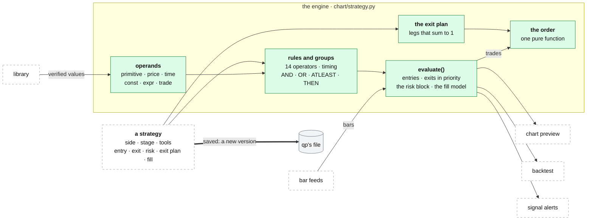

# The strategy engine

**Above:** [QUANT.md](QUANT.md) §3 (qp's parts).

**Talks to:**
- the [library](LIBRARY.md): every value a rule reads is a verified primitive;
- the [bar feeds](FEEDS.md): the bars it evaluates on;
- the [backtest](BACKTEST.md) and the [signal alerts](SIGNAL-ALERTS.md), which
  call the same evaluator;
- the [chart](CHART.md): the ⚡ strategy drawer where a strategy is built and
  checked;
- qp's own [file](../files/FILES.md) §3.4: strategies and their versions.

---

## 1. What it is

**The grammar of a strategy, and the one evaluator that turns it into
trades.** A strategy is a document of rules over verified indicators: when to
enter, when to exit, how much risk, and how the exit is split into legs. The
chart's preview, the backtest and the alerts all call the same
`strategy.evaluate()`, over the same primitive values the chart draws. There is
no second evaluator, so a signal on the chart is the signal the backtest
trades.

**What it never does:**
- infers an exit: the exit is declared, leg by leg;
- falls back silently: an unknown fill model or operator is an error;
- reads a value from the future: a coarser timeframe shows only its last
  completed bar, another symbol is aligned without look-ahead;
- places an order: the order function computes what a bracket order would be,
  and the backtest books it.

---

## 2. The diagram



---

## 3. Its parts

### 3.1 A strategy document

```json
{
  "name": "OR + VWAP 09:35 (Long)",
  "side": "long",
  "stage": "ready",
  "tools": ["T2"],
  "fill": "desk",
  "entry": { "logic": "AND", "rules": [ … ] },
  "exit":  { "logic": "OR",  "rules": [ … ] },
  "risk":  { "sl": {…}, "tp": {…}, "targets": [ … ], "window_start": 935, … },
  "exit_plan": { … }
}
```

| Field | Means |
|---|---|
| `side` | `long` or `short` |
| `stage` | `development` (where every new strategy starts) or `ready`. Set by hand, never earned automatically |
| `tools` | the screener tools whose registers the strategy is meant for; its default backtest universe. Refused on save if a tool does not exist |
| `fill` | the fill model of §3.6, default `desk`: used by the backtest, the alerts, and by default the preview |
| `entry`, `exit` | rule groups (§3.3, §3.4) |
| `risk` | stops, targets, discipline and size gates (§3.5) |
| `exit_plan` | optional: the exit declared leg by leg (§3.7) |

### 3.2 Operands: the values a rule compares

| Kind | Gives |
|---|---|
| `primitive` | a verified indicator from the library, with its source and parameters; `sub` picks one line of a multi-line one (a floor pivot's `R1`, Bollinger's `upper`, dynamic S/R `sr3`) |
| `price` | `close`, `open`, `high`, `low`, `hl2`, `hlc3`, `ohlc4`, `volume` |
| `time` | the bar's New York time: `minutes` since midnight, `hhmm`, `hour`, `minute` |
| `const` | a number |
| `expr` | `add`, `sub`, `mul`, `div` of two operands, nested freely; ÷0 gives no value. A body as % of the range is body ÷ range × 100; a move in ATR is (close − open) ÷ ATR |
| `trade` | **exit rules only:** the open position's `entry` price, `bars` held, unrealised `pnl_pct`; each trade sees its own |

| Modifier on any operand | Effect |
|---|---|
| `offset: n` | the value n bars ago (`close > high[1]`) |
| `hold: true` | carries the last real value forward until it changes (Pine's `fixnan`), applied before the offset: a sparse pivot high becomes a level a later bar can retest |
| `symbol` | read from another symbol (SPY), aligned bar by bar without look-ahead |

A primitive on a coarser timeframe (a daily ATR, an average volume) shows only
the last **completed** bar of that timeframe: no same-day look-ahead.

### 3.3 Rules

`{ "left": <operand>, "op": "gt", "right": <operand>, "op_params": {…}, "for_bars": 3, "within_bars": 5, "offset": 1 }`

| Operator | True when |
|---|---|
| `gt`, `lt`, `ge`, `le` | above, below, at or above, at or below |
| `eq`, `neq` | equal, not equal (tolerant of floating point) |
| `gt_pct`, `lt_pct` | above or below by **at least** `pct` % of the right side's size: `L ≥ R + |R|·pct/100` |
| `cross_above`, `cross_below` | the previous bar at or below (above), this bar above (below) |
| `rising`, `falling` | over `lookback` bars (default **12**): the line ends above (below) where it started, by at least `min_pct` % if set, and at least `consistency` (default **75 %**) of the non-zero bar-to-bar changes point that way. Flat bars do not count against it. `right` is ignored |
| `bounce_up`, `bounce_down` | the bar's wick comes within `tol_pct` of the level (default **0.15 %**) and it closes back on its side, in the top 60 % of its range for a bounce up (`close_pos`) |

**Any missing value makes a rule false:** warm-up, outside a session.

| Timing on a rule | True when |
|---|---|
| `for_bars: N` | it held on **all** of the last N bars (on a cross: the cross N−1 bars ago, the state kept since) |
| `within_bars: N` | it held on **any** of the last N bars |
| `offset: N` | it was true N bars ago (shifts the result; an operand's offset shifts a value) |

### 3.4 Groups

| Logic | True when |
|---|---|
| `AND` | all its rules hold |
| `OR` | any holds |
| `ATLEAST` (`k`) | at least k hold ("min core, min extra"); k below 1 counts as 1 |
| `THEN` (`window`) | its steps happen **in order**, each within `window` bars of the one before (default **10**): *above the 13-EMA* THEN *bounces up off the 13-EMA* |

Groups nest to any depth: `A and B and (C or D) and (E or F)`.

### 3.5 From rules to trades

**Entry:**
- `entry_mode: edge` (default): one entry per stretch of bars on which the
  entry group holds; a THEN sequence completing again is a new stretch;
- `entry_mode: status`: any bar on which it holds while flat, so it can re-enter
  after a stop while the setup still holds.

**Exit, in a fixed priority, on each bar while in a position:**
1. **The stop.** With a single target, when the stop and the target fall in the
   same bar, the stop wins. With scale-out legs, a leg target the bar traded
   through is banked first and the stop applies to what is left, as a real
   bracket does; `stop_first: true` makes the stop win instead.
2. **The target,** or the next scale-out leg.
3. **The exit rule,** as a status: it exits on any bar where the exit group
   holds, even if it held before the entry. A rule with a `trade` operand is
   evaluated per trade.
4. **The end of the day,** when the session rules force it: at that bar's
   close, reason `eod`.

A stop hit in profit (an anchored or trailing stop that moved) is recorded as
`trail`.

**The risk block:**

| Field | Means |
|---|---|
| `sl`, `tp` | `{type, value}`: `pct` of the entry, `atr` (× ATR14 at entry), `points` (dollars); or `{type: "prim", anchor, value}`: a level that **trails** an indicator bar by bar, shifted to the protective side (0.2 % under the 9-EMA for a long). `freeze: true` reads the level once at the signal bar and holds it ("2 cents under the low of the turn") |
| `targets` | scale-out legs, each `{fraction, r_multiple}` or `{fraction, tp}`; what the legs do not take stays until the stop, the exit rule or the close |
| `window_start`, `window_end` | `hhmm`: entries only inside |
| `max_entries_per_day` | per symbol |
| `cooldown_bars` | after an exit, no entry for this many bars (reset each day) |
| `min_hold_bars` | the exit rule is ignored this many bars after the entry |
| `max_stop_pct`, `min_stop_pct` | refuse an entry whose stop is further than, or closer than, N % (too close cannot pay for its own costs) |
| `min_target_usd` | refuse an entry whose nearest target is less than $X from the fill |
| `stop_first` | when a bar touches the stop and a leg target, the stop filled (default off) |
| `breakeven_after_target` | move the stop to the entry once the first target fills. **Today reported on the order plan and never simulated (Q-N7). The design: simulated, or refused on save until it is** |

**Session rules** (prop-firm style), passed with a run: entries only in regular
hours (`rth_entries`, from `entry_start` 09:30 to `entry_cutoff` 15:50); every
position flat at the day's last bar (`eod_close`); `max_entries_per_day`. With
a next-bar fill, a signal whose fill would land outside the window is dropped.

### 3.6 Fill models: the price a trade gets

| `fill` | Entry fills at | Stop and targets measured from | Use |
|---|---|---|---|
| `close` | the signal bar's close | the same close | the raw signal; optimistic by about a spread |
| `next_open` | the next bar's open | **the fill**: re-prices R from the fill, which a bracket order cannot do | comparison |
| **`desk`** (the default) | the next bar's open | **the decision bar's close**, as a bracket order is really priced | the honest backtest |
| `live` | the decision price | the decision bar's close | the real-time form of `desk` and `next_open`: the next bar's open has not printed when the signal bar closes. An alert of a `desk` strategy evaluates with `live`, so an alert and a backtest take the same bar |

**Why `desk` exists.** On 2026-08-19 a WULF short was decided at 15.37, filled
at 15.24, stop 15.74: 2.00 R as planned, 1.31 R if priced from the fill. `desk`
books the fill at the open and keeps every level where the decision put it.

**With a next-bar fill:** a signal on the last bar makes no trade; a stop fills
at its level on a touch, but at the **open** when the bar gaps through it (the
gap is charged); a target fills at its level.

**One fill model for the preview, the backtest and the alerts.** The strategy's
own `fill` is used by all three. The drawer can show the raw `close` signal,
labelled as not what the backtest books. Today the preview defaults to `close`.

### 3.7 The exit plan and the order

**The exit is declared, never inferred** (`exit_protocol.py`). Every strategy
reports the same structure, written or derived from `risk`:

```
exit_plan = {
  shape: "2 SL / 2 TP + runner",
  legs: [ {fraction 0.5, sl, tp}, {fraction 0.25, sl, tp} ],
  runner: {fraction 0.25, manage: "eod" | "manual"},
  ok, errors, warnings, derived
}
```

- **Every leg has its own stop:** a shared stop is filled in from `risk.sl`,
  explicitly.
- **The fractions sum to exactly 1:** a plan summing to 0.9 never orders a
  tenth of every position.

**The order** (`order_plan.py`) is one pure function: a trade and an account
in, the orders out, or the reason there are none.
1. The risk budget: `risk_usd`, or `risk_pct` of the account.
2. Shares = the budget ÷ the risk per share.
3. Caps, in order: the position cap (% of the account), the account ratio, the
   per-order value cap, the money left.
4. Below `min_shares`, nothing is sent.
5. One bracket per leg in whole shares; the odd shares go to the runner, or the
   last leg.
6. Prices in whole cents, rounded towards the entry.

The backtest books exactly these orders.

### 3.8 Building and checking one

In the chart's ⚡ strategy drawer ([CHART.md](CHART.md)):

| Tool | Does |
|---|---|
| **▶ Evaluate** | the strategy over the chart's window: entry ▲ and exit ▼ markers; the stop and target as the simulation used them (a fixed stop flat, an anchored one trailing its line); the indicators the rules read; whether entry and exit hold **now**; a quick preview (win rate, return, exits by reason). It can replay a backtest's exact fill and session settings |
| **🔍 test**, on any rule or group | marks every bar where it holds, draws the lines it reads, gives the left side's value now and how often it is true ("rising on 22 % of bars, TRUE now") |
| **the signal funnel** (`GET /api/strategy/explain`) | on one symbol and day, each entry step's count of true bars; the step at zero is the blocker |
| **the funnel over a register day** (`GET /api/strategy/explain_scan`) | who came closest to firing |
| **parity** (`parity.py`) | is the strategy saved today the one a backtest ran? |

**The working rule:** never trust a piece you have not seen. Plot the number,
test the condition, then compose.

### 3.9 Where strategies live, and their versions

| Copy | Where | Role |
|---|---|---|
| the working copy | qp's file, `~/.qp/platform.db`, table `strategies` | |
| **versions** | qp's file, `strategy_versions` (**to build**) | saving a strategy creates a version; a backtest records the versions it ran |
| JSON copies | `~/.qp/strategies/*.json`, written on every save | read back only when the file has **no** strategies (a new or wiped box); never merged into one that has |
| seeds | `chart/seeds/*.json`, in git | brought into the file at start. A seed marked `_keep_user_edits`, or edited in the browser, keeps the stored copy. One bad seed is skipped and named |
| backtest snapshots | each run stores a frozen copy of the strategies it ran | `tools/recover_strategies.py` can read a lost strategy back from them |

Today each backtest freezes a copy of its strategies; with versions it records
the versions, and the old runs keep their copies.

**The bundled seeds:**

| Seed | Side | Stage | Window |
|---|---|---|---|
| Test | long | ready | 09:30–11:30 |
| OR + VWAP 09:35 (Long, Short) | both | ready | 09:35 |
| T2 10:00 VWAP Extension (Long, Short) | both | ready | 10:00 |
| RubberBand Scalp (Long, Short), Second Chance, Back$ide, HitchHiker, Fashionably Late | long, one short | development | per scalp |
| PM Breakout (2m) | long | development | 09:30–10:00 |
| PML breakout (the trader's own, restore only) | short | development | 09:40–10:10 |

- The five SMB scalps, as specified and as built in this grammar:
  [legacy/qp/SCALPS.md](../../legacy/qp/SCALPS.md),
  [legacy/qp/SCALPS_SPEC.md](../../legacy/qp/SCALPS_SPEC.md).
- The three ready strategies also exist as Pine scripts for TradingView's
  Strategy Tester: [legacy/qp/PINE.md](../../legacy/qp/PINE.md).

---

## 4. Contracts

| It owns (qp's file) | Key |
|---|---|
| `strategies` | id |
| `strategy_versions` (to build) | id, version |

| Route (behind `/quant/`) | Does |
|---|---|
| `GET /api/strategies`; `POST /api/strategies`; `DELETE /api/strategies/{sid}` | list; save (a new version, once built); delete |
| `GET /api/strategies/{sid}` | the stored strategy, with its derived exit plan |
| `POST /api/strategies/{sid}/tools` | assign its tools only, without rewriting it |
| `POST /api/strategy/evaluate` | the strategy on one symbol: trades, markers, stop and target lines, entry and exit now, preview stats |
| `POST /api/strategy/test` | every bar where one rule or group holds |
| `GET /api/strategy/explain`, `GET /api/strategy/explain_scan` | the signal funnel, on a symbol or over a register day |

The full list: [legacy/qp/API.md](../../legacy/qp/API.md).

---

## 5. When it fails

| Event | What happens |
|---|---|
| a rule names an unknown primitive, operator or fill | refused, with the name |
| a strategy names a tool that does not exist | refused on save |
| an exit plan's fractions do not sum to 1, or a leg has no stop | the plan reports `ok: false` with the errors; no order is computed from it |
| a value is missing on a bar | the rule is false on that bar |
| the bars are short of the warm-up | the engine asks the feed for the warm-up it needs (`required_days`); what it cannot get stays NaN |

---

## 6. Built on

**The old desk:** [legacy/qp/STRATEGIES.md](../../legacy/qp/STRATEGIES.md),
written from `chart/strategy.py`, `exit_protocol.py`, `order_plan.py`,
`store.py`, `parity.py` and the strategy drawer.

**What failed there:**

| ID | Fault | Prevented by |
|---|---|---|
| Q-N9 | alerts used the `close` fill and backtests `desk` | one fill model (built for alerts, step 12) |
| Q-N7 | `breakeven_after_target` reported, never simulated | simulated, or refused on save |
| — | a backtest froze a copy of each strategy; nothing said which version a result came from | strategy versions |

---

## 7. Status

| Part | Status |
|---|---|
| the grammar, the evaluator, the risk block, the fill models, the exit plan, the order, the drawer's tools | **built** (legacy, kept) |
| alerts on the strategy's own fill | **built, live** (step 12) |
| the preview defaulting to the strategy's own fill | **to build** |
| `breakeven_after_target` simulated, or refused on save | **to build** |
| strategy versions | **to build** |
