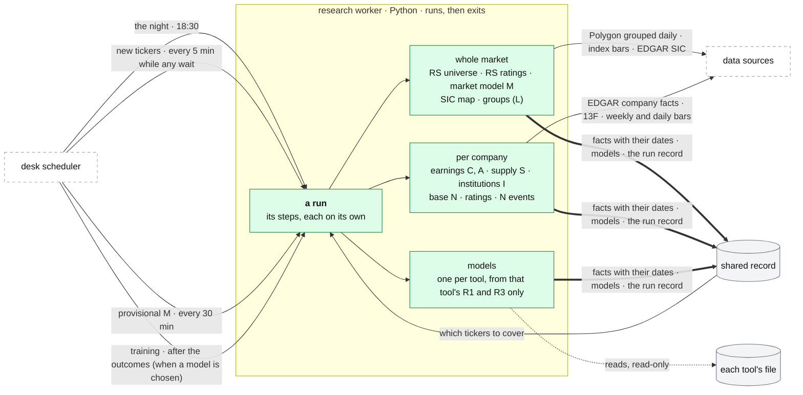

# The research worker

**Above:** [ARCHITECTURE.md](../../ARCHITECTURE.md) §4.5.

**Talks to:**
- the [desk](../desk/DESK.md), whose scheduler starts every run
  ([JOBS.md](../desk/JOBS.md));
- the [data sources](../outside/SOURCES.md): SEC EDGAR, Form 13F, Polygon,
  Yahoo;
- the [shared record](../outside/SHARED-RECORD.md), where it writes its facts;
- the tools' [files](../files/FILES.md), which it reads, read-only, to train
  models.

---

## 1. What it is

**The O'Neil research, done in one place.** For every stock the tools find,
and for the market as a whole, it works out what William O'Neil's method
(CANSLIM) asks:
- how fast the company's earnings are growing (C and A);
- whether the stock leads: its strength against the whole market (RS), and its
  industry group's rank (L);
- whether it is breaking out of a sound base, or has something new (N);
- the supply of its shares (S), and whether big funds are buying (I);
- whether the market itself is in a confirmed uptrend (M).

It is a **job, not a program that stays up.** The desk's scheduler starts it;
it works through its steps, writes each result with its date into the shared
record, records its run, and **exits**.

**It is the only writer of:**
- every O'Neil fact: the letters above, and the ratings;
- the industry map: which industry each company belongs to, from its SEC
  filings (its SIC code);
- when a model is chosen, the tools' models.

**What it never does:**
- stay running;
- start on its own;
- make a page wait;
- write a tool's file.

**Why it is separate.** Today the O'Neil research lives inside qp, the chart
program, and each tool asks qp about each new stock:
- a stock first seen while qp is down or restarting gets a blank reading;
- a tool's morning record taken then keeps those blanks for good;
- five tools ask about the same stocks.

O'Neil results are card fields and Market-tab sections, so their writer must
not depend on the chart program being up.

---

## 2. The diagram

---

## 3. Its parts

### 3.1 The runs

| Run | When (New York, trading days) | Steps |
|---|---|---|
| **the night** | 18:30, once the day's whole-market bars are published | every step, then the backup ([BACKUPS.md](../outside/BACKUPS.md)) |
| **new tickers** | every 5 minutes, 04:00–16:00, while any ticker carded today has no company facts and no attempt today | the per-company steps, for those tickers only |
| **provisional M** | every 30 minutes in the session | the market model on today's index bars so far, written as **provisional**; the night's run replaces it |
| **training** | after the outcomes (about 16:20), when a model is chosen | one model per tool, from that tool's own history only ([LEARNING.md](../desk/tool/LEARNING.md)) |
| **by hand** | a button, or a command | any step. It asks the scheduler to start the job; no page waits |

**New tickers the same morning.**
- EDGAR allows ten requests a second, so a morning's new tickers land within
  minutes.
- Until they land, the card says "computing · since 09:41".
- RS, the group and the SIC code already exist for every US stock, from the
  whole-market steps.

### 3.2 The steps

Each step is independent. One failure never stops the rest, and each failure is
reported with its reason.

| # | Step | Writes (fact family) | Clock |
|---|---|---|---|
| 1 | RS universe top-up | `bars_universe` (Polygon grouped daily, the newest sessions) | each close |
| 2 | RS ratings | `rs_rating` per ticker, with the universe size | each close |
| 3 | market model | `oneil_m`: state, per-index counts, distribution days, rally, follow-through, the rules in use | each close; every 30 minutes in the session, provisional |
| 4 | SIC map | `sic` per ticker | nightly, for new listings and changes |
| 5 | groups | `group_ranking`; `oneil_l` per ticker (group, level, rank, percentile, letter, RS in group, rotation) | each close |
| 6 | earnings | `oneil_c`, `oneil_a` per ticker | weekly, and on a new 10-Q or 10-K |
| 7 | supply | `oneil_s` per ticker | monthly (shares); each close (U/D, A/D) |
| 8 | institutions | `oneil_i` per ticker | quarterly, after the 45-day filing deadline |
| 9 | base and RS line | `oneil_n_base`, `rs_line` per ticker | each close (weekly bars) |
| 10 | ratings | `oneil_ratings`: RS, group, A/D, volume against its 50-day average; later EPS, SMR, Composite | each close |
| 11 | N events | `oneil_n_events` per ticker | nightly, over 24 months |
| 12 | distribution days per stock | `oneil_dd` per ticker | each close |

**Which tickers each night:**
- **Whole-market steps (1–5)** cover every US stock.
- **Per-company steps (6–12)** cover:
  - every ticker any tool carded in the last 90 days;
  - every R1 ticker;
  - every ticker in an open trade.

  A ticker carded for the first time is covered the same morning by the
  new-ticker run.

**Which tickers to cover** is read from the shared record:
- the desk records each carded ticker (`research_wanted`);
- the worker records each attempt (`research_attempts`).

**Budgets.** The per-company steps have a time budget per night. Whatever does
not fit is covered on the following nights, oldest first.

The method behind each letter, its rules, thresholds and traps:
[ONEIL.md](ONEIL.md).

### 3.3 Facts, with their dates

Every fact it writes carries:
- **`as_of`:** the date it describes (the quarter end, the session, the 13F
  quarter);
- **`known_at`:** when the worker learned it;
- **`status`:** `ok`, `none` (no filings) or `unavailable` (EDGAR timed out),
  with the reason;
- **the rules in use**, for anything with a threshold, so a signal can be
  checked against its definition later.

So a backtest's CANSLIM gate reads exactly the letters known before its
decision bar, and a photo records exactly the reading of its minute.

### 3.4 Who reads what

| Reader | Reads | Never |
|---|---|---|
| the desk's card pipeline | the O'Neil facts of the card's ticker ([CARD.md](../desk/tool/CARD.md)) | computes any of them |
| the desk's market reader | the latest `oneil_m`, final or provisional, and `group_ranking` ([MARKET.md](../desk/MARKET.md)) | computes any part of them |
| qp | any of them, as of a day ([BACKTEST.md](../quant/BACKTEST.md)) | writes them |
| the journal | the facts known at a trade's entry ([REVIEW.md](../journal/REVIEW.md)) | writes them |
| pages | through the card and the market state | trigger a build |

### 3.5 Its switch

`researchMode` (in `data/keys.json`) has three settings:
- **shadow:** the cards keep qp's values, and the facts are compared beside them
  field by field.
- **on:** the cards read the facts; qp is asked only for tickers not covered
  yet.
- **off.**

---

## 4. Contracts

| It owns (only writer), in the shared record | Subject |
|---|---|
| `bars_universe`, `group_ranking`, `oneil_m` | `MARKET` |
| `rs_rating`, `rs_line`, `sic`, `oneil_l`, `oneil_c`, `oneil_a`, `oneil_s`, `oneil_i`, `oneil_n_base`, `oneil_n_events`, `oneil_ratings`, `oneil_dd` | ticker |
| `research_attempts`, `research_runs` | — |
| models (when chosen) | tool, question, version |

| It reads | From |
|---|---|
| EDGAR (company facts, the ticker map, 8-K items, SIC), Form 13F datasets, Polygon grouped daily, Yahoo index and stock bars | the data sources ([SOURCES.md](../outside/SOURCES.md)) |
| the tickers to cover | `research_wanted`, written by the desk |
| R1 and R3 of a tool, to train its model | that tool's file, read-only |

**Its run record.** Each run writes a `research_runs` row: its start and end,
each step's result, and counts (tickers covered, facts written, failures with
reasons). The scheduler's own run record holds the same outcome. A step that has
not succeeded within its clock turns the health page amber, then red, and
alerts. For example: earnings not refreshed in 8 days.

---

## 5. When it fails

| Event | What happens |
|---|---|
| a step fails | the other steps run. The failure is recorded with its reason, and the facts keep their old dates, so cards say "last run DATE" |
| a run does not happen, or hangs | the scheduler records it as missed or hung, and alerts |
| a source is slow or limited (EDGAR: ten requests a second) | the step works within its budget and carries the rest to the next night |
| it runs out of memory at night | the run fails and alerts. The night's run happens at 18:30, when no scan is due, with swap behind it ([BOX.md](../box/BOX.md)) |
| the shared record is down | nothing can be written, so the run fails and alerts. Nothing is written anywhere else |

---

## 6. Built on

**The code it runs:** `quant-platform/research/worker.py`, reusing qp's
O'Neil code, which was checked rule by rule: `relstrength.py`, `oneil.py`,
`groups.py`, `edgar.py`, `f13.py`, `base.py`, `ratings.py`, `sic.py`.

**The old desk:**
- the O'Neil chain as built inside qp:
  [legacy/qp/CANSLIM.md](../../legacy/qp/CANSLIM.md), 1,646 lines, the deepest
  document of the old desk;
- its nightly job: a systemd timer, Monday to Friday at 22:30 UTC, six steps
  ([legacy/qp/OPERATIONS.md](../../legacy/qp/OPERATIONS.md)).

**What failed there:**
- The chain runs inside the chart program. Every tool asks qp for its new
  tickers' values and caches them for the day.
- A new ticker's earnings arrive only if a page shows its card, or the nightly
  walk reaches it.
- The nightly job runs from a hand-installed timer. Without it, the O'Neil data
  goes stale with no alarm (Q-N5).
- The industry map had two writers and flipped every morning (F-21).
- When an O'Neil file is missing, the Market tab asks qp to build it inside a
  page request.

---

## 7. Status

| Part | Status |
|---|---|
| the worker: the O'Neil readings written as dated facts; new tickers within minutes; provisional M | **built, in shadow** (step 7). The cards still read qp's values |
| its runs started by the desk | **partly**: the new-ticker and provisional-M runs are started by T1's scheduler; the night's run is the last step of qp's own nightly job, on its systemd timer |
| the whole chain inside the worker (steps 1–12), started by the desk's night job | **to build** (step C): today the chain's computations run in qp's nightly job and the worker publishes their results |
| `rs_line`, `oneil_s`, `oneil_n_events`, `sic` as facts; the ratings beyond RS, group and A/D | **to build** ([ONEIL.md](ONEIL.md) §6) |
| training models | **prepared, no model** (by the trader's choice; [LEARNING.md](../desk/tool/LEARNING.md)) |
