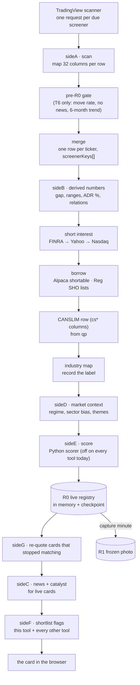

# The scanner's data pipeline

How a screener tool finds a stock, where every piece of information about it
comes from, how it is processed, and how it ends up on a **card** and in the
**registers**. Written from the code (`src/pipeline.js` and the `side*`
folders it calls); every endpoint, threshold and field name below is the one
the code uses.

Related documents:

| | |
|---|---|
| `docs/REGISTERS.md` | every register (R0–R4, Shortlist), when it is written and every column |
| `docs/CARD.md` | the card's layout, section by section, and its display rules |
| `CARD-FIELDS.md` | every field on a card, its source, and when a blank is legitimate |
| `docs/MARKET-TAB.md` | the Market tab: indexes, O'Neil model, regime, sectors, groups |
| `METHODOLOGY.md` | what each tool's screeners hunt for and why |

Everything here happens **inside each tool's own process** (T1, T2, T6, T7,
T11 today). Each tool runs this pipeline against its own screeners and keeps
its own results. The only things tools share are files of facts about the
market (see *Shared facts* at the end).

---

## 1. The shape of it

Two kinds of run:

| Run | When (New York time, weekdays) | What it does |
|---|---|---|
| **Discovery scan** (`runFullScan`) | 04:00–09:00 every 30 min · 09:00–10:00 every 5 min · 10:00–16:00 every 15 min · 16:00 | All 12 stages below. Only screeners inside their run window are asked. |
| **Refresh** (`runRefreshOnly`) | every 5 min, 04:00–16:00 | Re-quotes every card already on screen (one batched TradingView call), recomputes derived numbers. No new cards, no news, no re-scoring. |

A run is skipped when the tool is paused, or when another run is still going.

---

## 2. Stage by stage

Each stage is **fatal** (a failure ends the scan and leaves the cards already
on screen untouched) or **soft** (a failure is logged in the scan report and
the scan carries on without that information).

### Stage A — the TradingView scan (fatal)

`src/sideA/tvScanner.js`

- **Endpoint:** `POST https://scanner.tradingview.com/america/scan?label-product=screener-stock`
  with a browser User-Agent, Origin and Referer of tradingview.com, 15 s timeout.
- **Which screeners:** every enabled screener of this tool whose run window
  contains the current minute (`screenerStore.isActiveAt`). Each is one request,
  sent in parallel.
- **Request body:** the screener's own filters **plus the tradability floor**
  (`tradable.serverFilters`: price ≥ $1, 10-day average volume ≥ 1M, ATR ≥ $1),
  a base filter (common/preferred stock, depositary receipts and non-ETF funds;
  no pre-IPO), the screener's sort, and a page of 50 rows (or the screener's
  own `limit`).
  - The **Unexplained Move** screeners (T6) keep only the price floor.
  - A **label-only** screener (T8's CANSLIM Universe) takes no floor, and its
    rows never become cards.
- **Columns asked for (32), and the card field each becomes:**

| TradingView column | Card field | | TradingView column | Card field |
|---|---|---|---|---|
| `close` | `price` | | `High.1M` / `Low.1M` | `monthHigh` / `monthLow` |
| `open` | `open` | | `High.5D` / `Low.5D` | `weekHigh` / `weekLow` (5 trailing sessions) |
| `change` | `change` (% today) | | `High.3M` / `Low.3M` | `quarterHigh` / `quarterLow` |
| `change_from_open` | `_changeFromOpen` | | `price_52_week_high/low` | `yearHigh` / `yearLow` |
| `relative_volume_intraday\|5` | `rvol` (preferred) | | `High.All` | `allTimeHigh` |
| `relative_volume_10d_calc` | `rvol` (fallback when the intraday one is empty or 0) | | `high` / `low` | `dayHigh` / `dayLow` |
| `VWAP` | `vwap` | | `ATR` | `atr` (14-day) |
| `EMA9` `EMA13` `EMA20` `EMA50` | `ema9` … `ema50` | | `premarket_high/low` | `pmHigh` / `pmLow` |
| `SMA5` | `sma5` | | `market_cap_basic` | `mcap` |
| `sector` / `industry` | `sector` / `industry` | | `float_shares_outstanding` | `floatShares` |
| `short_percentage_of_float` | `shortFloat` (TradingView never fills it — see short interest) | | `ticker-view` + the row's symbol | `ticker`, `tvSymbol` (e.g. `NASDAQ:AAPL`) |

- **Safety checks on every answer:**
  - **Column alignment (D-S3):** if the row length differs from the 32
    columns asked for, the whole batch is refused rather than shifting every
    field by one.
  - **Range sanity:** a warning when two range windows come back identical for
    most rows.
  - **ATR % floor, locally:** rows whose ATR is under 3 % of price are dropped
    (`tradable.applyLocal`). TradingView cannot compare two columns, so this
    leg runs here. A missing ATR is kept, not dropped.
- **Output:** `candidates` = `{ screenerName: [rows] }`; label-only screeners
  go to a separate `labels` pile.

### The pre-R0 gate — T6 only (inside stage A)

`src/sideA/preR0.js` — applies only to the `unexplained-move` and
`unexplained-move-mirror` screeners. Three tests, in this order, before
anything reaches the registry:

| Test | Data | Rule |
|---|---|---|
| **Move rate** | Alpaca 1-minute bars for today (`fetchIntradayBars`) | ≥ +15 % (mirror: ≤ −15 %) over the **last 120 minutes**, measured close to close. No full 120-minute window = dropped. |
| **No news** | `fetchNewsForTicker` (the full news stack, below) | any catalyst = dropped. A failed lookup = dropped. |
| **Six-month trend** | Alpaca daily closes **before today** (`fetchClosesBefore`), 126 sessions | base: dropped if the six months rose more than 20 %; mirror: dropped if they fell more than 20 %. Under 126 sessions = dropped. |

Survivors carry `move2hPct` and `trend6mPct` onto their card. Every drop is
counted with its reason in the scan report. If the gate itself throws, the
candidates pass through untouched (an empty scan would look like a quiet
market).

### Merge

`src/sideA/merge.js` — one row per ticker across every screener of the tool.
`screenerKeys` lists every screener that matched it this scan. Where two
screeners returned the same ticker, a field empty in the first is filled from
the second; a value is never overwritten.

### Stage B — derived numbers (fatal)

`src/sideB/calculations.js` and `relations.js`. Pure arithmetic on the fields
above; a missing input gives a missing output, never a zero (F-14).

| Field | Formula |
|---|---|
| `prevClose` | `price / (1 + change/100)` |
| `gapPct` | `(open − prevClose) / prevClose × 100` |
| `pmRange` | `pmHigh − pmLow` |
| `adrPct` | `atr / price × 100` |
| `pmAdrRatio` | `pmRange / atr` (0 when ATR is 0) |
| `weekRangePos`, `monthRangePos`, `quarterRangePos`, `yearRangePos` | `(price − low) / (high − low) × 100` |
| `dist<Level>` for EMA 9/13/20/50, SMA 5, VWAP, prev close, open, PM high, PM low | `(price − level) / |level| × 100`, 3 decimals |
| `vs<Level>` | `above` / `below` (sign of the distance) |
| `aboveAllMas` / `belowAllMas` | all four EMAs known and all above / all below |
| `maStack`, `maStackScore` | count of EMA9>13, 13>20, 20>50: 3 = `bull`, 0 = `bear`, else `mixed` |
| `monthQuarter` | month-range position: <25 `Q1`, <50 `Q2`, <75 `Q3`, else `Q4` |
| `pmAdrBand` | PM/ADR ratio: `<0.5`, `0.5-1`, `1-2`, `2-3`, `3+` |
| `dayRangePos` | `(price − dayLow) / (dayHigh − dayLow) × 100` |

The relation fields live in `row.signals`; the rest in `row.stock`.

### Short interest (soft)

`src/sideC/shortInterest.js` — only for cards with no `shortFloat` yet.
TradingView's column is always empty, so three sources are tried in order:

1. **FINRA's own file**: `cdn.finra.org/equity/regsho/monthly/shrt{date}.txt`,
   then the OTC biweekly paths. One file covers every symbol and is cached for
   the day. It gives shares short, and the percentage uses the card's float.
2. **Yahoo** `quoteSummary` (per symbol; cookie and crumb from `fc.yahoo.com`).
3. **Nasdaq** `api.nasdaq.com/api/quote/{t}/short-interest` (per symbol, with
   two weeks of history).

Writes `shortFloat`, `shortBasis` (`float`, or `outstanding` when no float is
known, which understates it), `shortAsOf`, `shortSrc`, `shortTrend` and
`daysToCover`. A success is cached per ticker for the day; a failure is not.

### Borrow (soft)

`src/sideC/borrow.js` — two different questions, never merged:

| Field | Source | Meaning |
|---|---|---|
| `shortable`, `easyToBorrow`, `borrowNote` | Alpaca assets API (paper endpoint unless `APCA_API_BASE_URL` says otherwise), per symbol, cached | will the broker let you short it now |
| `regSho`, `regShoDay`, `regShoNote` | Nasdaq `nasdaqth{yyyymmdd}.txt` + NYSE threshold-securities download, for the settlement day | is it on the Reg SHO threshold list (a symptom of hard borrow) |

Every value is true, false or null. Null means the question could not be
asked; it never means "no".

### CANSLIM row (soft)

`src/sideA/canslimRow.js` — puts the O'Neil reading on the row, so it is
frozen into R1. It reads the same sources the card's CANSLIM section reads,
all from **qp** over localhost (`QP_URL`, default `127.0.0.1:8765`) and its
shared files:

| qp source | Columns |
|---|---|
| `/api/oneil/fundamentals` (EDGAR, cached only) | `csEpsChg`, `csSalesChg`, `csQuarter`, `csAccelerating`, `csBeats`, `csGrowth3yr`, `csStability`, `csRoe` |
| `/api/oneil/base` (weekly bars) | `csBaseWeeks`, `csBaseDepth`, `csPivot`, `csPctToPivot`, `csBaseScore`, `csHandle` |
| `/api/oneil/ratings` | `csUdRatio`, `csAdLetter`, `csRsLineTell` |
| `data/oneil-groups.json` | `csGroup`, `csGroupLevel`, `csGroupRank`, `csGroupOf`, `csRsInGroup`, `csGroupMembers` |
| `/api/oneil/13f` | `csFunds`, `csFundsChg`, `csFundsDir` |
| `data/oneil-market.json` + `/api/oneil/stock` | `csMarket`, `csDdChecked`, `csDdHeld`, `csDdAvgRel`, `csDdVerdict` |

Each value is null when its source has nothing. A failed source never fails
the scan.

### Industry map (soft)

`src/sideA/industryMap.js` — records each row's TradingView sector and
industry into `data/industry-map.json`, **only for symbols the nightly SIC
pass has not classified** (F-21: SIC wins). qp ranks industry groups from
this map.

### Stage D — market context (soft)

`src/sideD/engine.js` — builds the market snapshot once per scan, then stamps
every row's `context`. Full detail in `docs/MARKET-TAB.md`.

- **Data:** TradingView scanner again: SPY, QQQ, IWM, DIA, VIX and 15 sector
  ETFs, with columns close, change, change|1W, SMA5/20/50/200, Bollinger
  upper/lower, ADX, VWAP, relative volume.
- **Stamped on each row:** `regime`, `regimeLabel`, `longTerm`, `midTerm`,
  `shortTerm`, `broadResolved` (the row's TradingView sector mapped to one of
  the 15 sector ETFs), `secBias`, `secScore`, `secHot`, and `themes` (from a
  ticker list and an industry list in `sideD/themes.js`).
- If SPY **and** QQQ are both incomplete, there is **no regime this scan**:
  the rows keep no context rather than a made-up bearish one (D-S2).

### Stage E — score (soft)

`src/sideE/score.js` — sends each row's features to the tool's Python scorer
(`SCORER_URL`). Every tool runs with the scorer **off by configuration**
today (the deploy prints `scorer: off (by config)`), so `_score` is null on
every card. See *D-D1* in `docs/KNOWN-ISSUES.md`. A manual long/short bias and
an already-known catalyst are carried into the score request.

### Into R0

Every existing card is marked not-live, then the scan's rows are upserted
into the **live registry** (`src/r0/registry.js`). A new ticker gets an id,
`firstSeen`, `bias: auto`. An existing one keeps its id, `firstSeen`, its
shortlist star and the earliest time each screener matched it (`seenAt`), and
takes the scan's new numbers. A card that stopped matching stays on screen,
marked **Stale**.

### Stage G — re-quote stale cards (soft)

`src/sideG/staleFetch.js` — cards no longer returned by any screener are
re-quoted by symbol (batches of 200, the same 32 columns), so their price and
levels keep moving. Enriched fields that the plain quote does not carry
(short interest, borrow, move rate, trend) are carried over.

### Stage C — news and catalyst (soft)

`src/sideC/news.js` and `technical.js` — for every **live** card.

- **Sources, in parallel:**

| Source | Endpoint | Needs |
|---|---|---|
| TradingView news | `news-headlines.tradingview.com/v2/headlines` | nothing |
| Alpaca (Benzinga) | `data.alpaca.markets/v1beta1/news` | Alpaca key |
| Yahoo | `query1.finance.yahoo.com/v1/finance/search` | nothing |
| SEC EDGAR full-text search | `efts.sec.gov/LATEST/search-index` | a User-Agent |
| Finnhub | `finnhub.io/api/v1/company-news` | Finnhub key |
| Google News RSS | `news.google.com/rss/search` | only asked when the five above returned fewer than 2 items |

- **Filtering:**
  - stories older than **21 days** are not shown;
  - market round-ups (lists of movers, more than 8 related symbols) are dropped;
  - law-firm class-action notices never count as catalysts;
  - the same headline from several sources is kept once, with its earliest
    time.
- **Catalyst:** each headline from the last **7 days** is matched against 39
  categories in three tiers:
  - **tier 1:** FDA approval or rejection, trial result, earnings beat or
    miss, guidance, M&A target, offering, bankruptcy, short report;
  - **tier 2:** upgrade, downgrade, contract, partnership, buyback, splits,
    index changes, listing status, legal risk;
  - **tier 3:** insider trades, product, management, restructuring.

  The score is the tier base (100 / 60 / 30), plus 8 per corroborating
  headline (up to 3), plus a recency adjustment (+15 under a day, +5 under
  two, −10 under four, −25 older). The best score is the catalyst, and the
  rest are kept as `others`.
- **Technical catalysts** (the tape, not a story), from the card's own
  numbers:
  - Gap Up/Down: |gap| ≥ 4 % on ≥ 2.5× volume.
  - Big Move: |change| ≥ 2× ADR % and ≥ 5 %, on ≥ 2× volume.
  - Volume Surge: ≥ 5× volume with |change| ≥ 2 %.
  - Monthly Breakout/Breakdown: through the 1-month high or low on ≥ 2×
    volume.
  - Squeeze Setup: short float ≥ 20 %, up ≥ 3 %, on ≥ 3× volume.

  A technical catalyst leads only when there is no fresh news, and it never
  sets bias.
- **Auto bias** (`sideC/bias.js`):
  - a manual long/short always wins;
  - else a fresh, non-technical tier-1 bull or bear catalyst decides;
  - a tier-2 one decides unless both the short-term market and the sector
    oppose it;
  - else the market and sector context decide;
  - else "no read".
- Written to the row as `news` (each source's items and status, `agedOut`,
  `fetchedAt`), `catalyst` and `autoBias`.

### Stage F — shortlist flags (soft)

`src/sideF` — marks `inShortlist` from this tool's shortlist, and
`shortlistedBy` / `shortlistedElsewhere` from the unified list every tool
publishes (`data/shortlist-all.json`).

### After the scan

- The whole registry is written to `r0_checkpoint` (one row in the tool's
  database). On restart the tool reloads it when it is from the same day, so a deploy does not empty the
  screen for the rest of the day.
- At midnight the registry is cleared. A scan that finds yesterday's rows also
  clears it.

---

## 3. The refresh (every 5 minutes)

`runRefreshOnly` → `staleFetch.refreshAllInR0`:

- re-quotes **every** card of today by symbol;
- recomputes the derived numbers and relations;
- carries the enriched fields over.

The score a card got at discovery is not recomputed. If TradingView answers
with misaligned columns, that batch is refused.

---

## 4. Where each kind of information comes from

| Information | Source | When |
|---|---|---|
| Candidates, prices, levels, ranges, volume, float, cap, sector | TradingView scanner | every scan and refresh |
| Derived numbers and relations | computed | every scan and refresh |
| Move rate, six-month trend (T6) | Alpaca bars | each T6 scan |
| Short interest, days to cover | FINRA file → Yahoo → Nasdaq | once per ticker per day |
| Shortable | Alpaca | once per ticker per process |
| Reg SHO threshold | Nasdaq and NYSE daily files | once per settlement day |
| CANSLIM letters | qp (EDGAR, bars, 13F, market model, groups) | every scan, from qp's caches |
| Market regime, sector bias, themes | TradingView (indexes, sector ETFs), computed | every scan |
| News, catalyst, auto bias | 5 news sources + Google fallback | every scan, live cards |
| Score | Python scorer | every scan (off today) |
| Outcomes (R3) | Yahoo bars → Alpaca bars | 16:05 |

## 5. Shared facts, and who writes them

| File | Written by | Read by |
|---|---|---|
| `data/industry-map.json` | qp's nightly SIC pass (wins); each tool for unclassified symbols | qp's group ranks |
| `data/oneil-market.json` | qp | every tool (CANSLIM M, R2) |
| `data/oneil-groups.json` | qp | every tool (CANSLIM L, Market tab) |
| `data/oneil-13f.json` | qp | every tool (CANSLIM I) |
| `data/shortlist-all.json` | every tool, its own section | every tool (`★ also` badge) |

Each one is a **label, never a filter**: no tool's candidates change because
of what is in these files.
