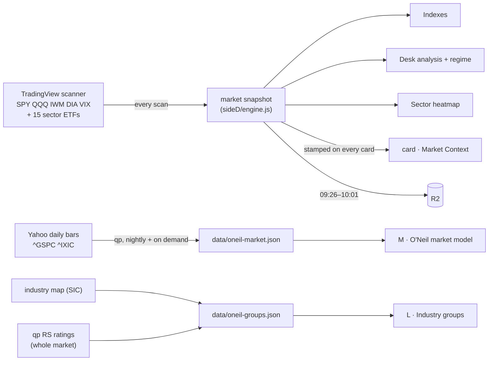

# The Market tab

Every block on a tool's **Market** tab: where its numbers come from, how each
verdict is computed, every threshold, and where the same numbers also land
(each card's Market Context, and register R2). Written from
`src/sideD/*.js`, `src/routes/market.js`, `quant-platform/chart/oneil.py`,
`quant-platform/chart/groups.py` and the Market tab code in
`public/index.html`.

Two systems sit on this tab, kept apart on purpose:

| System | Built by | Answers | Blocks |
|---|---|---|---|
| **The desk's read** | each tool, on every scan | what the tape is doing right now | Indexes, Desk analysis, Sector heatmap |
| **O'Neil's method** | qp, after each close | should you be buying at all, and where the leadership is | M · market model, L · industry groups |

---

## Where the data comes from

- **The snapshot** is built at the start of the market-context stage of each
  discovery scan (`buildMarketSnapshot`). The tab reads the latest one through
  `GET /api/market/snapshot`; if none exists yet it builds one on the spot.
- **TradingView columns asked for:** `close`, `change`, `change|1W`, `SMA5`,
  `SMA20`, `SMA50`, `SMA200`, `BB.upper`, `BB.lower`, `ADX`, `VWAP`,
  `relative_volume_10d_calc`.
- **No regime rather than a wrong one.** If SPY and QQQ are both missing any
  of close/SMA5/20/50/200, the scan records no regime (D-S2) and the cards keep
  no context.
- **O'Neil files** are published by qp (nightly at 22:30 UTC, and on request
  when missing). `GET /api/market/oneil` and `/api/market/groups` ask qp to
  build them when the file is absent.

Folds: **Indexes** and **M · O'Neil market model** open by default; the rest
closed. Which folds are open is remembered in the browser.

---

## 1. Indexes · live

Five tiles in order **SPY, QQQ, DIA, IWM, VIX**: price, change today, change
over the week. Tapping a symbol opens its chart.

## 2. M · O'Neil market model

qp's reconstruction of O'Neil's market direction from the **S&P 500 (^GSPC)**
and the **Nasdaq Composite (^IXIC)**, daily bars from Yahoo.

### The rules (`oneil.py` THRESHOLDS)

| Rule | Value | Meaning |
|---|---|---|
| Distribution day | close down **≥ 0.2 %** on volume **higher than the prior session** | institutions selling |
| Stalling day | heavy volume (above the prior session or the 25-day average), close in the **lower half** of the range, gain **under 0.2 %** | selling absorbed: also counts as distribution |
| Live window | **25 sessions** | a distribution day expires after 25 sessions… |
| Recovery | index **trades 5 % above** that day's close (intraday high) | …or when the index has moved 5 % past it |
| Under pressure | **5** live distribution days | |
| Correction | **6** live distribution days, or the uptrend's low broken | |
| Rally attempt, day 1 | the session after the **lowest close** of the correction | a lower close restarts the count |
| Follow-through day | day **4 or later**, gain **≥ 1.7 %**, volume above the prior session | confirms a new uptrend; "late" after day 7, "very late" after day 11 (still counted) |

Volume above the 50-day average is **reported** beside a follow-through but
does not decide it.

### Status

Each index is walked forward through its own state machine; the **published
status is the worse of the two indexes**:

| Status | Shown as | What O'Neil does (the tab's text) |
|---|---|---|
| `confirmed_uptrend` | Confirmed uptrend | Buy breakouts. This is the state the method is designed for. |
| `uptrend_under_pressure` | Uptrend under pressure | Stop initiating new positions; tighten stops on open ones. A name holding up through distribution is a leader candidate for the next follow-through. |
| `market_in_correction` | Market in correction (including a rally attempt with no follow-through yet) | No new buying. Three out of four stocks follow the market, and this one is going down. |

### What the block shows

- the status, its date, and a **because** line (e.g. "5 distribution days
  live on the Nasdaq Composite (5 is the threshold)");
- **Live distribution** per index;
- the **Follow-through**: date, day number, gain, timing;
- **Since the FTD**: the number of sessions, with a band;
- the **Rally attempt**: day N off a dated low;
- the exposure guidance above;
- a **distribution-day table**: date, index, kind (distribution or stalling),
  move %, volume ratio, sessions until it expires;
- the rules in use, a caveat (roughly one follow-through in four fails), and
  the model note (a reconstruction from O'Neil's published descriptions).

Also on each card: CANSLIM **M** (status, live distribution days, and how this
stock behaved on those days). In R2: `oneilStatus`, `oneilDistributionDays`,
`oneilSessionsSinceFtd`, `oneilFtdDate`.

## 3. Desk analysis

The desk's own read, in three cards plus a final regime. Computed from SPY
(QQQ when SPY is incomplete) unless noted.

### Short-term bias (`computeMarketBiasDetail`)

| Signal | +1 | −1 |
|---|---|---|
| SPY day | > +0.3 % | < −0.3 % |
| QQQ day | > +0.3 % | < −0.3 % |
| IWM day | > +0.3 % | < −0.3 % |
| VIX day | < −2 % (+1) | > +1 % (−1), > +3 % (−2) |
| SPY week | > +1 % | < −1 % |
| QQQ week | > +1 % | < −1 % |

Sum ≥ **+3** BULLISH, ≤ **−3** BEARISH, otherwise NEUTRAL. The card shows the
score and each signal.

### Mid-term stage (`computeMarketStage`)

Six checks, counted as bull signals:

1. close > SMA5
2. close > SMA20
3. SMA5 > SMA20
4. SMA20 > SMA50
5. "1H close > 20H MA". The code uses the daily close > SMA20 as a proxy,
   which is check 2 again.
6. "1H 5MA > 20H MA". The code uses SMA5 > SMA20, which is check 3 again.

Checks 5 and 6 repeat 2 and 3, so the count runs on four distinct facts, two of
them counted twice. See *D-D5*.

| Stage | Rule |
|---|---|
| UPTREND | ≥ 5 bull, or 4 with close > SMA5 |
| PULLBACK | 3–4 bull, close < SMA5, SMA5 > SMA20 |
| REBOUND | 2–3 bull, close > SMA5, SMA5 < SMA20 |
| SIDEWAYS | 2–3 bull otherwise |
| DOWNTREND | fewer |

Bollinger position (close between the bands): ≥ 75 % `UPPER`, ≤ 25 % `LOWER`,
else `MID`.

### Long-term bias (`computeLongTermBias`)

| | SMA50 > SMA200 (golden cross) | SMA50 < SMA200 |
|---|---|---|
| **close > SMA200** | BULLISH | RECOVERING |
| **close < SMA200** | WEAKENING | BEARISH |

Also shown: the distance from the 200-day in %.

### Final regime (`computeRegime`)

Long-term × mid-term, then the Bollinger overlay:

| Long \ Mid | UPTREND | PULLBACK | REBOUND | SIDEWAYS | DOWNTREND |
|---|---|---|---|---|---|
| **BULLISH** | STRONG_UP | PULLBACK_BULL | UP | CHOP_BULL | CORRECTION |
| **RECOVERING** | WEAK_UP | RECOVERY | RECOVERY | BASING | DOWN |
| **WEAKENING** | RECOVERY | TOPPING | BEAR_RALLY | CHOP_BEAR | DOWN |
| **BEARISH** | BEAR_RALLY | DOWN | BEAR_RALLY | BASING | STRONG_DOWN |

STRONG_UP at the upper band becomes **EXTENDED_UP**; STRONG_DOWN at the lower
band becomes **CAPITULATION**.

| Regime | Stance | Guidance (as shown) |
|---|---|---|
| Extended Up | LONG | Market extended. Momentum strong. Pullbacks are buying opportunities. |
| Strong Uptrend | LONG | Strong bullish conditions. Favor long setups with momentum. |
| Uptrend | LONG | Bullish but recovering. Favor long setups selectively. |
| Weak Uptrend | LONG | Recovering from weakness. Light long bias. |
| Pullback (bull intact) | LONG | Short-term pullback in a bull market. Watch for long re-entries. |
| Recovery | NEUTRAL | Recovering structure. Be selective. Wait for confirmation. |
| Basing | NEUTRAL | Market is basing. No clear direction. Reduce exposure. |
| Chop (bull bias) | NEUTRAL | Choppy but leaning bullish. Trade small and be selective. |
| Chop (bear bias) | NEUTRAL | Choppy with bear undertone. Reduce position size. |
| Correction (bull intact) | NEUTRAL | Correction in a bull market. Monitor for stabilization before re-entering. |
| Topping | SHORT | Signs of topping. Reduce longs. Hedge or go short on weakness. |
| Bear Rally | NEUTRAL | Counter-trend rally in bear market. Fade strength cautiously. |
| Downtrend | SHORT | Bearish conditions. Avoid longs. Short on rallies. |
| Strong Downtrend | SHORT | Strongly bearish. Reduce all risk. Short only. |
| Capitulation | SHORT | Market in capitulation. Extreme caution. Watch for reversal signals. |

**Confidence** is high when long and mid term agree (both bullish-side or both
bearish-side), medium otherwise; **Aligned / Diverging** says the same.

On each card: `regime`, `regimeLabel`, `longTerm`, `midTerm`, `shortTerm`.

## 4. Sector heatmap

15 ETFs: XLK Technology, XLF Financial, XLI Industrial, XLY Consumer
Discretionary, XLE Energy, XLV Health Care, XLC Communication Services, XLU
Utilities, XLB Materials, XLRE Real Estate, XLP Consumer Staples, SMH
Semiconductors, IBB Biotechnology, XRT Retail, XTN Transportation.

Columns: Sector, ETF, Daily %, Week %, **RS Day** (ETF day − SPY day), **RS
Week** (ETF week − SPY week), Bias, Score, ADX, Status (🔥 HOT). Sorted by
score.

### Score (`sectorShortTermBias`)

1. Five checks: close > SMA20 · SMA20 > SMA50 · close > VWAP · RS day > 0 ·
   week > 0.
2. `base = checks / 5 × 100`.
3. `RS influence = RS day × 5`, clamped to ±30.
4. ADX factor: **1.3** if ADX > 25, **1.1** if 20–25, **0.8** below 20.
5. `score = round((base + RS influence) × ADX factor)`, clamped to ±100.
6. Bias: score > **20** BULLISH, < **−20** BEARISH (settings
   `sectorBullishThreshold`, `sectorBearishThreshold`), else NEUTRAL.

The score is lopsided: with no checks met it bottoms out around −39, while
all five can reach +100 (F-16, open).

### Hot (`updateHotSector`, per trading day)

- **Hot at once** when the score reaches **60** (`hotImmediateThreshold`).
- **Hot after 3 trading days** (`hotSustainedSessions`) whose best score
  reached **40** (`hotSustainedThreshold`).
- **Stays hot** while the day's best score is at least **20**
  (`hotFloorThreshold`). After **2** days below that (`coolOffDays`) it cools
  off.
- Counted per ET trading day, not per scan (F-17). The state lives in the
  tool's memory, so a restart starts it again; Settings has a reset.

On each card: `broadResolved` (the card's TradingView sector mapped to one of
the 15), `secBias`, `secScore`, `secHot` (the 🔥 HOT badge). In R2: each
sector's bias, score, change and hot, plus counts of bullish and bearish
sectors.

## 5. L · Industry groups

qp ranks **industry groups across the whole market**, the level O'Neil says
carries about 37 % of a stock's move (the sector carries 12 %).

| Step | How |
|---|---|
| Membership | the industry map: **SIC codes from EDGAR** for every filer (TradingView labels only for symbols SIC has not classified, F-21) |
| Strength | each stock's RS rating from qp, ranked against the whole market |
| Group strength | the **median** member RS (one strong stock cannot carry a weak group) |
| Thin groups | a group with fewer than **6** ranked members (`QP_GROUP_MIN_MEMBERS`) is merged one rung up: 4-digit industry → 3-digit **industry group** → 2-digit **major group**; still too thin at the top, dropped |
| Ranking | groups ranked 1 … N by median RS; percentile and a letter (A+ ≥ 94 … E) |
| Rotation | rank three months ago → rank now: **into** / **out of** leadership |
| Refresh | nightly after the SIC pass; cached 12 hours; on request when missing |

The table shows the **top 20** and the **weakest 10**:

- **Rank X of N**;
- **Group** name, marked *rolled up* when merged;
- **Pct** with its letter;
- **Members**;
- **Median RS**;
- **Over 80**, the share of members with RS over 80;
- **3mo**, the rank three months ago → now, coloured by rotation;
- **Leaders**, the top four members with their RS.

The note above the table gives how many symbols and industries are mapped,
and how many groups have enough members to rank.

On each card: CANSLIM **L** (group, level, rank, RS inside its group, rotation)
and the `csGroup*` columns in R1.

---

## Who uses what on this tab

| Number | Card | R1 | R2 | Model features |
|---|---|---|---|---|
| Regime, long/mid/short term | Market Context | ✓ | ✓ | ✓ |
| Sector bias, score, hot | Market Context, 🔥 HOT | ✓ | ✓ (all 15) | bias and score (not hot) |
| Index prices | — | — | ✓ | — |
| O'Neil status | CANSLIM M | `csMarket` | ✓ (read at export) | — |
| Group rank | CANSLIM L | `csGroup*` | — | — |
