# The registers

What each tool writes down, when, where it is stored, and every column. A
register is how a day of screening becomes data that qp can backtest, the
scorecard can grade, and the model can learn from. Written from
`src/warehouse/registers.js`, `src/sideH/capture.js`, `src/scheduler.js` and
`src/db/index.js`.

How the numbers get onto a row in the first place is in
`docs/DATA-PIPELINE.md`. Each tool has its own database (`data/tradedesk.db`
for T1, `data/t<N>.db` for the others), so every register below exists once
per tool.

---

## The day, in registers

```mermaid
gantt
  dateFormat HH:mm
  axisFormat %H:%M
  section Live
  R0 live registry (every scan, refresh every 5 min) :active, 04:00, 16:00
  section Morning
  R2 market snapshots (8 slots)       :09:26, 10:01
  Shortlist auto-rule (1 min before R1):milestone, 09:35, 0m
  R1 photo (per tool, e.g. 09:36)     :milestone, 09:36, 0m
  section After the close
  R3A / R3B outcomes                  :milestone, 16:05, 0m
  R4A / R4B training rows             :milestone, 16:05, 0m
  Model auto-train                    :milestone, 16:20, 0m
```

| Register | Written | Trigger | Table | One row per |
|---|---|---|---|---|
| **R0** | continuously | every scan and refresh | memory + `r0_checkpoint` | ticker, today |
| **R1** | once, at the tool's capture minute | scheduler `R1 Capture HH:MM` | `r1_frozen` | ticker, date |
| **R2** | 09:26, 09:31, 09:36, 09:41, 09:46, 09:51, 09:56, 10:01 | scheduler | `r2_market_snapshots` | slot, date |
| **R3A / R3B** | 16:05 | scheduler `R3 EOD Capture` | `r3a` / `r3b` | ticker, date |
| **R4A / R4B** | read time (R1 joined to R3) and 16:05 into the training tables | R3 capture | `r4a_train` / `r4b_train` | ticker, date |
| **Shortlist** | on every star and at the auto-rule minute | the card's ☆, the auto-rule | `shortlist` | date (a list of items) |

Capture times per tool (`tools.config.json`, editable on Manage tools):

| Tool | R1 photo | Entry A | Entry B |
|---|---|---|---|
| T1, T7 (and T3, T9) | 09:36 | 09:37 | 09:40 |
| T2, T11 (and T5, T8, T10) | 09:46 | 09:47 | 09:51 |
| T4 | 10:01 | 10:02 | 10:06 |
| T6 | 10:16 | 10:17 | 10:21 (see D-S9: before T6's 11:30 window) |

---

## R0 — the live registry

What the screen shows. Built by every scan (`docs/DATA-PIPELINE.md`), kept in
the process's memory, checkpointed to the database after each scan,
reloaded on a same-day restart, cleared at midnight.

- **Holds every card of today:** live ones (matched by a screener this scan)
  and stale ones (matched earlier, no longer matching).
- **Exported columns:** the same set as R1 below, plus `liveNow` and
  `lastUpdated`. The full row also carries `news`, `catalyst` (with tier,
  score, evidence and others), `autoBias`, `seenAt`, `shortlistedBy` and
  `_scoreDetails`, which the card reads directly.

---

## R1 — the day's photo

**The only thing the model learns from**, and what qp backtests over.

- **When:** the tool's capture minute (one minute after one of its discovery
  scans, so the photo is fresh).
- **What:** `captureR1` takes **every R0 row of today**, live or stale, and
  stores each row's **complete JSON** in `r1_frozen.data`. A re-capture on
  the same day replaces it.
- **Exported columns** (`/api/warehouse/R1/<date>`, CSV export, R2 backups):

| Group | Columns | Source |
|---|---|---|
| Identity | `ticker`, `date`, `capturedAt` | — |
| State at the photo | `inShortlist`, `_score`, `bias` | R0 |
| Price | `price`, `prevClose`, `open`, `change`, `gapPct`, `vwap` | TradingView, derived |
| Moving averages | `sma5`, `ema9`, `ema13`, `ema20`, `ema50` | TradingView |
| Volatility, volume | `rvol`, `atr`, `adrPct`, `dayHigh`, `dayLow` | TradingView, derived |
| Ranges | `weekHigh/Low/RangePos`, `monthHigh/Low/RangePos`, `quarterHigh/Low/RangePos`, `yearHigh/Low/RangePos`, `allTimeHigh` | TradingView, derived |
| Size | `mcap`, `floatShares` | TradingView |
| Short interest | `shortFloat`, `daysToCover`, `shortBasis`, `shortAsOf` | FINRA / Yahoo / Nasdaq |
| Pre-market | `pmHigh`, `pmLow`, `pmRange`, `pmAdrRatio` | TradingView, derived |
| Classification | `sector`, `industry`, `screenerKeys`, `themes` | TradingView, desk |
| Market context | `regime`, `regimeLabel`, `longTerm`, `midTerm`, `shortTerm`, `broadResolved`, `secBias`, `secScore`, `secHot` | desk (sideD) |
| Relations (27) | `vsEma9 … vsPmLow`, `distEma9 … distPmLow`, `maStack`, `maStackScore`, `monthQuarter`, `pmAdrBand`, `dayRangePos`, `aboveAllMas`, `belowAllMas` | derived |
| CANSLIM (31) | `csEpsChg`, `csSalesChg`, `csQuarter`, `csAccelerating`, `csBeats`, `csGrowth3yr`, `csStability`, `csRoe`, `csBaseWeeks`, `csBaseDepth`, `csPivot`, `csPctToPivot`, `csBaseScore`, `csHandle`, `csUdRatio`, `csAdLetter`, `csRsLineTell`, `csGroup`, `csGroupLevel`, `csGroupRank`, `csGroupOf`, `csRsInGroup`, `csGroupMembers`, `csFunds`, `csFundsChg`, `csFundsDir`, `csMarket`, `csDdChecked`, `csDdHeld`, `csDdAvgRel`, `csDdVerdict` | qp |
| Catalyst | `catalyst` (label only) | news |
| Cross-tool | `shortlistedElsewhere` (`yes`/`no`) | unified shortlist |
| Timing | `foundMinsFromOpen` (earliest screener match, minutes from 09:30; negative = pre-market) | R0 `seenAt` |

- **In the stored JSON but not in the exported columns:**
  - `shortSrc`, `shortTrend`;
  - `shortable`, `easyToBorrow`, `regSho`, `regShoDay`;
  - `move2hPct`, `trend6mPct`;
  - the full `catalyst` object, `news`, `seenAt`, `autoBias`,
    `_changeFromOpen`.

  They are frozen, so the history exists, and a column can be added to the
  export without losing any past day.

---

## R2 — market snapshots

The market around the photo: eight snapshots between 09:26 and 10:01. Each
stores the whole market snapshot (`docs/MARKET-TAB.md`) as JSON. **Skipped
when no scan has built a snapshot yet.**

| Group | Columns |
|---|---|
| When | `date`, `slot` (ET `HH:MM`), `capturedAt` |
| SPY | `spyClose`, `spyChange`, `spyWeekChg`, `spySma5`, `spySma20`, `spySma50`, `spySma200`, `spyBbUpper`, `spyBbLower` |
| QQQ | `qqqClose`, `qqqChange`, `qqqWeekChg`, `qqqSma5`, `qqqSma20`, `qqqSma50`, `qqqSma200` |
| IWM, DIA, VIX | `iwmClose`, `iwmChange`, `iwmWeekChg`, `diaClose`, `diaChange`, `vixClose`, `vixChange`, `vixWeekChg` |
| Desk read | `regime`, `regimeLabel`, `shortBias`, `shortScore`, `midStage`, `longBias`, `sectorBullish`, `sectorBearish` (counts), `breakouts` (up to 5 symbols up > 3 % on > 2× volume) |
| O'Neil (read at export time) | `oneilStatus`, `oneilAsOf`, `oneilDistributionDays`, `oneilSessionsSinceFtd`, `oneilFtdDate` |
| Per sector (15 ×) | `sec_<Sector>_bias`, `sec_<Sector>_score`, `sec_<Sector>_change`, `sec_<Sector>_hot` |

The O'Neil columns are read from the current `data/oneil-market.json` when the
register is **exported**, not when the snapshot was taken, so an old R2 day
shows today's O'Neil status. See *D-D3* in `docs/KNOWN-ISSUES.md`.

---

## R3A / R3B — what happened after the photo

At 16:05 (`captureR3`), for every ticker in today's R1:

1. **Bars:** 1-minute bars for the day from **Yahoo**, then **Alpaca** for any
   ticker Yahoo returned empty. Daily bars from Yahoo, else Alpaca. Batches of
   100.
2. **ATR14:** from daily bars strictly before today (no look-ahead).
3. **Entry A** = the **open** of the bar at the tool's entry A minute; **Entry
   B** the same at entry B. No bar at that minute = no row for that ticker
   (logged as `missing HH:MM bar`).
4. From the entry bar to the close: `hh` = highest high, `ll` = lowest low.
5. `upR = (hh − entry) / ATR14`, `downR = (entry − ll) / ATR14`, both positive.
6. **Opening range** 09:30–09:35 high and low.

| Register | Columns |
|---|---|
| R3A | `date`, `ticker`, `entryPriceA`, `hhA`, `llA`, `atr14`, `upR_A`, `downR_A`, `capturedAt` |
| R3B | `date`, `ticker`, `entryPriceB`, `hhB`, `llB`, `atr14`, `upR_B`, `downR_B`, `capturedAt` |

The opening range is stored (`or_high`, `or_low` in both tables) but not
exported — see *D-D4*. A **good move** is `upR ≥ 1.3`.

---

## R4A / R4B — the training rows

R1 joined to R3A (or R3B) on ticker. Read live from the two tables whenever
asked; at 16:05 the rows **with an outcome** are also copied into
`r4a_train` / `r4b_train`, which is what the model trains on (16:20) and what
Analysis exports and accepts as uploads.

| Group | Columns |
|---|---|
| From R1 | `date`, `ticker`, `_score`, `inShortlist`, **`price936`** (R1's `price`; the name is historical, see P-1), `prevClose`, `open`, `change`, `gapPct`, `vwap`, `sma5`, `ema9/13/20/50`, `rvol`, `atr`, `adrPct`, `dayHigh`, `dayLow`, `monthHigh`, `monthLow`, `monthRangePos`, `mcap`, `floatShares`, `shortFloat`, `pmHigh`, `pmLow`, `pmRange`, `pmAdrRatio`, `sector`, `industry`, `screenerKeys`, the market-context columns, `themes`, `bias`, the 27 relation columns, `catalyst`, `shortlistedElsewhere`, `foundMinsFromOpen` |
| From R3 | `entryPrice{A,B}`, `hh{A,B}`, `ll{A,B}`, `atr14`, `upR_{A,B}`, `downR_{A,B}`, `capturedAt` |

**Narrower than R1.** R4 does not carry the 31 CANSLIM columns, the week,
quarter and year ranges, `allTimeHigh`, `daysToCover`, `shortBasis` or
`shortAsOf`. All of them are in R1 for the same day. See *D-D2*.

---

## Shortlist

One row per date in `shortlist`, holding a list of items:

| Column | Meaning |
|---|---|
| `date`, `ticker`, `tvSymbol` | — |
| `addedAt` | when it was starred |
| `method` | `manual` (the card's ☆) or `auto` (the auto-rule) |
| `price`, `change`, `sector`, `score` | the card's values at that moment |
| `exported`, `exportedAt` | copied to TradingView from the Shortlist tab |

- **Auto-rule:** one minute before the R1 photo, the top `shortlistTopN`
  (default 5) cards with a score of at least `shortlistMinScore` (default 70)
  are added once per day. With the scorer off on every tool, no card has a
  score, so the auto-rule adds nothing. See *D-D1*.
- **Unified list:** every change is published to `data/shortlist-all.json`;
  other tools show `★ also T2` on the same ticker. `inShortlist` stays this
  tool's own decision.

---

## Reading the registers

| Where | How |
|---|---|
| A tool's **Warehouse** tab | pick a date and a register; CSV or JSON export |
| HTTP | `GET :<tool port>/api/warehouse/available-dates?register=R1`, `GET …/api/warehouse/<REG>/<date>` (login required from outside the box) |
| qp | reads them over localhost for charts, R1 sheets and backtests |
| Cloudflare R2 | nightly CSV per tool × register × day under `analysis/` — `docs/BACKUPS.md` |
| Archived tools | the archive process serves the same `/api/warehouse` GETs, read-only |
