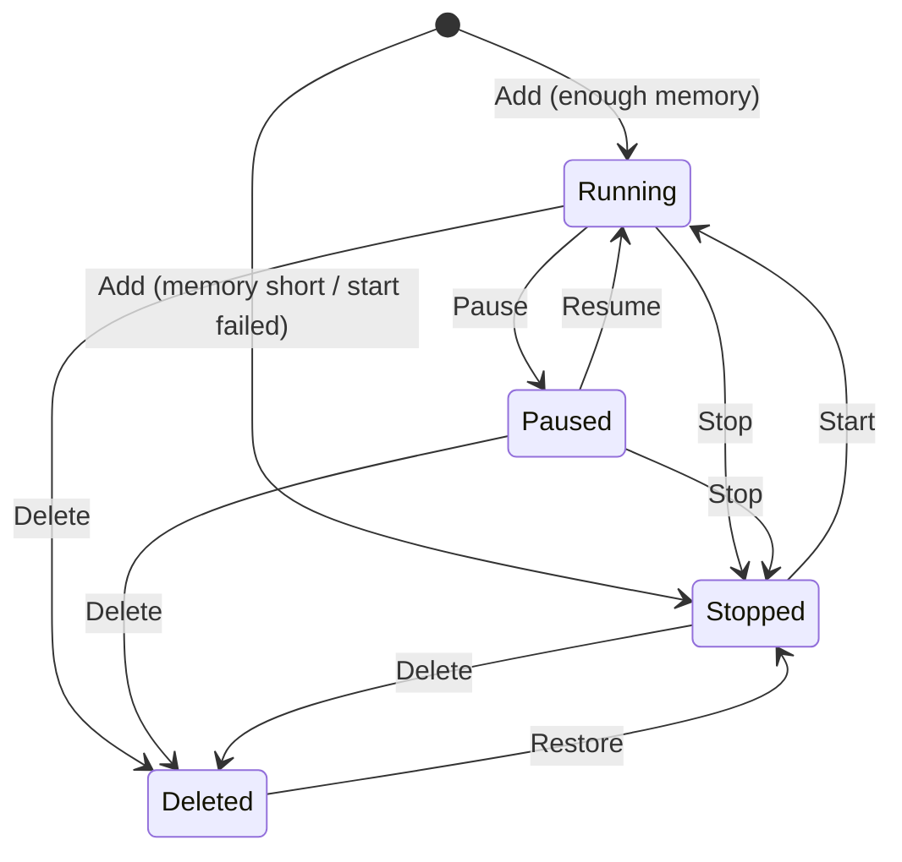

# Tool lifecycle

How a screener tool is added, started, paused, stopped, deleted and restored,
and what happens underneath each button of **Manage tools**
(`/screeners/manage`). Written from `src/toolsManager.js`,
`src/toolsRegistry.js`, `src/routes/toolsManage.js`, `deploy/tool-ctl.sh`,
`src/archive/server.js` and `src/sideA/toolIdentity.js`.

Related: how to use the page (`docs/USER-GUIDE.md`), the whole system
(`docs/ARCHITECTURE.md`), the routes (`docs/API.md`).

---

## What a tool is

Every tool is **its own program**: its own pm2 process, port, database, scorer
and memory ceiling, so a broken tool cannot take another down with it.

| | T1 | any other tool T*n* |
|---|---|---|
| pm2 process | `tool-T1` | `tool-Tn` |
| scorer process (when it has one) | `scorer-T1` on port + 1 | `scorer-Tn` on port + 1 |
| database | `data/tradedesk.db` | `data/tn.db` |
| model folder | `src/scoring/outputs` | `src/scoring/outputs-tn` |
| temp folder | `tmp` | `tmp-tn` |

The process gets `TOOL_ID`, `TOOL_NAME`, `PORT`, `DB_PATH`,
`MODEL_OUTPUT_ROOT`, `TMP_DIR` and `SCORER_URL` from `deploy/tool-ctl.sh`.

**T1 is special.** It serves the landing page and Manage tools, so it can be
neither stopped nor deleted, and the Manage tools routes exist on T1 only.

---

## The registry: which tools exist

Two files, merged by `src/toolsRegistry.js`:

| File | Holds | Written by |
|---|---|---|
| `tools.config.json` (in the repo) | the built-in tools: id, name, port, flags, description | a code change |
| `data/tools.local.json` (on the box) | tools added from the page, and overrides of any tool | Manage tools |

Everything that lists tools (the landing page, the archive, qp, the deploy)
reads the merged result, so they cannot disagree.

**Overrides** may change only `name`, `desc`, `accent`, `captureAt` and
`enabled`, plus the markers `deleted` and `pendingRestart`. Ports and ids
belong to the registry. The file is written to a temp file and renamed, so a
crash never leaves half a file.

**Three flags, three questions:**

| Flag | Means | Absent means |
|---|---|---|
| `enabled` | the deploy starts it; it scans | true |
| `archive` | when stopped, the archive serves its stored registers on its port | false for built-in tools; true for tools added from the page |
| `scorer` | it has a Python scoring process | true (added tools: false) |

Merge rules: a deleted tool is always disabled and archived; a tool switched
on is never archived (it holds its own port); a tool switched off is archived
if it was added from the page or its override does not say otherwise.

---

## Adding a tool

`POST /api/tools/manage` with `name`, and optionally `desc`, `accent`,
`captureAt`.

1. **Limit:** at most **6** added tools alive (deleted ones do not count).
2. **Id:** one past the highest id ever used, deleted tools included, so an
   id and the history filed under it are never reused.
3. **Port:** the next free multiple of ten past every port in use by a tool,
   its scorer or an app; the scorer port is port + 1.
4. **Defaults:** no scorer; the next accent colour in the palette; capture
   times 09:36 / 09:37 / 09:40.
5. **Start:** if there is enough memory (below), it is started at once;
   otherwise it is created stopped and the message says why.
6. qp is told to re-read its list of sources.

The new tool has **no screeners**; you build them on its own page.

### Capture times (`captureAt`)

`{ r1, entryA, entryB }`, each `HH:MM`:

- they must run in order: `r1 < entryA < entryB`;
- inside the session: `r1 ≥ 09:30`, `entryB ≤ 15:50`;
- an optional `why` note is kept with them.

---

## The buttons

| Button | Route | What happens |
|---|---|---|
| **Start** | `POST /:id/start` | refused if deleted (restore first) or if memory is short. Marks it enabled; if the archive was serving it, the archive is restarted first so it lets go of the port; runs `tool-ctl.sh start`. If that fails, it is marked disabled again and the archive restored. Then qp re-reads its sources |
| **Stop** | `POST /:id/stop` | not T1. `tool-ctl.sh stop` (deletes the pm2 process and its scorer), marked disabled, any pending restart cleared, the archive restarted so it now serves this tool's history, qp re-reads |
| **Pause** / **Resume** | `POST /:id/pause` / `resume` | calls the tool's own `/api/tool/pause` or `resume`. The program stays up; it stops **scanning** only (below) |
| **Scan now** | `POST /:id/scan` | calls the tool's `/api/scan/run`. Waits 4 s; if the scan is still going it says "is scanning", otherwise how many rows, or that the tool is paused |
| **Edit** | `PUT /:id` | name, description, colour, capture times. A new name is sent to the running tool at once; a new name or colour makes qp re-read. Capture times: see the session rule |
| **Delete** | `DELETE /:id` | not T1. Stops it, marks it deleted and disabled (off every list), restarts the archive so its history stays readable, qp re-reads. **Nothing is erased** |
| **Restore** | `POST /:id/restore` | takes the deleted mark off; it comes back **stopped** — press Start |

All routes are under `/api/tools/manage` on T1. Each answers
`{ ok, message, … }`, or `400 { ok: false, error }` with the reason.

### The two guards

1. **Memory.** A tool is not started (by Start or Add) with less than
   **180 MB** available (`TOOLS_MIN_FREE_MB`), read from `/proc/meminfo`. On a
   912 MB box the alternative is the kernel choosing what to kill, and it may
   choose sshd. If memory cannot be read, the start goes ahead.
2. **The session rule.** Capture times are read when a tool starts, so a
   change needs a restart, and a restart empties the list the tool has built
   since 04:00. So a capture-time change on a running tool:
   - **04:00–16:30 ET on a weekday:** saved, marked `pendingRestart`, and
     applied at **16:50** by T1's job "Apply tool schedule changes", after the
     last capture (16:05) and training (16:20);
   - **any other time:** the tool is restarted at once.

   T1 restarting itself runs the command detached, so it survives its own
   restart.

---

## Pause in detail

Stored in the tool's own database (`tool.paused` = `{ at, reason }`), so a
pause survives a restart.

- A paused tool's discovery scans and refreshes return at once, saying it is
  paused (`docs/MONITOR.md`).
- Cards already found stay on screen; the registers are not touched.
- Its status (`/api/scan/status`, `/api/monitor`, `/api/tool`) says paused,
  since when and why, so a quiet tool is never mistaken for a broken one.

Why pause exists: the tools are separate experiments; pausing one stops it
from collecting more without destroying what it has.

---

## `deploy/tool-ctl.sh`

**The one place a tool is started.** `deploy-tools.sh` calls it for every
enabled tool, and Manage tools calls it for the one pressed, so a tool started
from the phone gets exactly what a deploy gives it.

```
bash deploy/tool-ctl.sh start   T13
bash deploy/tool-ctl.sh stop    T13
bash deploy/tool-ctl.sh restart T13
bash deploy/tool-ctl.sh archive
```

| Action | Does |
|---|---|
| `start` / `restart` | looks the tool up in the merged registry; stops any old process; starts `scorer-Tn` (unless `scorer: false`) and `tool-Tn` with the tool's environment and memory cap; `pm2 save` |
| `stop` | deletes `tool-Tn` and `scorer-Tn`; `pm2 save` |
| `archive` | restarts the single `archive` process to serve every tool that is archived and disabled; with none, it does not run |

Details that matter:

- **A clean environment.** Run from inside a tool, the script would inherit
  that tool's pm2 settings (its name, id, log paths, `TOOL_ID`, `PORT` …). It
  clears them first, so a tool started from T1's page gets nothing of T1's.
- **Memory caps** (pm2 restarts the process above them):

  | Process | Cap |
  |---|---|
  | T1 | 280M |
  | T2, T6 | 240M |
  | T11 | 200M |
  | T7 | 180M |
  | any other tool | 140M (`TOOL_MAX_MEM`) |
  | a scorer | 180M (`SCORER_MAX_MEM`) |
  | the archive | 120M (`ARCHIVE_MAX_MEM`) |

  A single tool's cap can be set with `TOOL_MAX_MEM_<ID>`.
- `TOOL_CTL_NO_SAVE` skips `pm2 save` (the deploy saves once at the end).
- It does not pull, install or touch any other process.

---

## The archive

One read-only process (`src/archive/server.js`, about 45 MB) opens each
archived tool's database and answers the same `/api/warehouse/*` routes on
**that tool's own port**. qp reads tools over HTTP, so from qp's side a
stopped tool is unchanged: same URL, same JSON. Without it, stopping a tool
would take every chart and backtest of its history with it.

It has no scanner, scheduler, scorer or write route. It is restarted
(`tool-ctl.sh archive`) whenever the set of stopped tools changes: on Stop,
Delete, and before Start of an archived tool, so it releases that port.

---

## The life of a tool, end to end



| State | Program | Scans | History readable |
|---|---|---|---|
| Running | up | yes | yes, by the tool |
| Paused | up | no | yes, by the tool |
| Stopped | down | no | yes, by the archive (if archived) |
| Deleted | down, hidden from lists | no | yes, by the archive |
