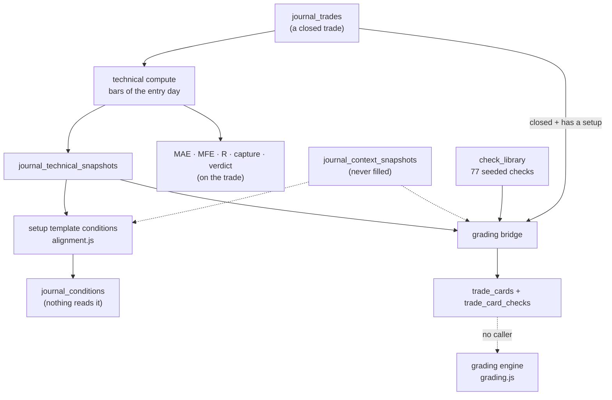

# After a trade lands: technicals, conditions and grading

What the journal's server computes about a trade once it is stored, where the
data comes from, and how much of it works. None of the results here are shown
on the page ([PAGE.md](PAGE.md#what-the-page-cannot-do)).

Written from `journal/src/journal/technicalFetch.js`, `alignment.js`,
`bridgeToGrading.js`, `analysis.js`, `journal/src/trading/checks.js`,
`grading.js`, `dailyLevels.js`, `volumeBaseline.js`, `historicalCache.js` and
`journal/src/alpaca/client.js`.

**In short.** Three layers were built: a technical snapshot of the entry, two
separate systems of "conditions" judged against it, and a grading engine meant
to learn which conditions pay. The snapshot is computed, but some of its
values are wrong or use data from after the entry. Most conditions can never
be judged, because their inputs are never stored. The grading engine has no
caller and no input: it needs R, and no trade has a stop.

---

## Technical compute

### When it runs

| Trigger | Which trades |
|---|---|
| after a **file import** | every newly stored trade, in the background, 300 ms apart |
| `POST /api/journal/trades/:id/compute` | that trade (and its conditions, when its setup has a template) |
| `POST /api/journal/compute-all` | every closed trade with `technical_computed = 0`, in the background |

A trade fetched from an **Alpaca account** or added by hand is **not**
computed until one of the two routes is called, and **no button** calls
either.

### Where the bars come from

One trading day of **1-minute bars**, for the trade's `date`:

1. **Yahoo** chart API, `interval=1m`, regular session only, window
   `09:30–16:00` written with a **fixed −05:00 offset**.
2. On any Yahoo error: **Alpaca** `/v2/stocks/bars`, `1Min`, same window,
   unadjusted. The feed is the broker profile's (if one exists), else the
   `alpacaMarketFeed` setting, else `iex`.

Yahoo serves 1-minute bars only for recent weeks, so older trades rely on
Alpaca.

**The Alpaca key**, first found wins: an enabled Alpaca row in
`trading_brokers` (only in databases carried from the old app), the
`alpacaApiKey`/`alpacaApiSecret` settings, `data/keys.json` (or
`SHARED_KEYS_FILE`), the first account in `journal-accounts.json`. With none:
*"Alpaca credentials not set — add an Alpaca account on the journal page, or
set data/keys.json"*.

**The window is wrong half the year (D-J8).** −05:00 is New York's winter
offset. From March to November the window asked for starts at **10:30** New
York time. A trade entered between 09:30 and 10:29 then finds no entry bar,
and the code falls back to the **last bar of the day**. Its snapshot, MAE and
MFE then describe the close, not the entry. Checked:
`new Date('2026-06-05T09:30:00-05:00')` is 10:30 in New York.

### What is computed

All indicators run on **that day's bars only**, from the first bar of the
window:

| Value | How |
|---|---|
| entry bar | the bar whose New York `HH:MM` equals the trade's entry time; **if none, the last bar** |
| price | the entry bar's close |
| VWAP | typical price × volume, cumulative from the first bar |
| EMA 9, 13, 20, 50 | seeded with the simple average of the first N closes (EMA 50 is blank for the first 49 minutes) |
| SMA 5, 9, 13, 20 | simple averages |
| Bollinger (20, 2) | 20-bar mean ± 2 population standard deviations |
| price vs VWAP and each EMA | `above`, `below` or `at` |
| EMA stack | 1 when EMA 9 > EMA 13 > EMA 20, else 0 |
| Bollinger zone | `upper` when price > the middle band, else `lower` |
| open, high, low, volume | of the entry bar |
| `prev_close` | the close of the **previous 1-minute bar**, not of the previous day |
| RVOL | entry bar volume ÷ the 10-day average for that minute. **Always blank**: the volume baseline is never built in the journal |
| ATR | a column exists; **never computed** |
| pre-market high/low, sector hot | read from `r1_frozen`. **Always blank**: nothing writes that table in the journal's database |
| multi-day levels | see below |

**MAE / MFE.** From the entry bar to the exit bar, or to the end of the day
when the exit bar is not found. MFE is the best excursion (high − entry for a
long, entry − low for a short), MAE the worst (low − entry, or entry − high).
Both are stored as % of the entry price.

**R, capture and verdict.** R = P&L per share ÷ \|entry − stop\|. Capture =
P&L per share ÷ MFE × 100. The verdict is `great` ≥ 80, `ok` ≥ 50, `early` ≥ 20,
else `poor`. **All three are computed only when the trade has a stop**, so
today all three are blank (D-J9).

**Multi-day levels** (`dailyLevels.computeLevels`, written for the old live
engine): 5-day MA (1,950 one-minute closes) and its 60-bar slope, 2-day /
week / month VWAP, week and month high/low, prior-day high/low. They are
computed on the cached history plus the day's bars. The history cache is
**never filled** in the journal, so:

- 5-day MA, its slope and prior-day high/low are **always blank**;
- 2-day, week and month VWAP and week/month high/low are computed from **the
  one day**, over **all of its bars, including those after the entry**: a
  look-ahead (D-J13).

### Where it is stored

The snapshot goes to `journal_technical_snapshots` (one row per trade,
replaced each time). The trade gets `mae_pct`, `mfe_pct`, `r_multiple`,
`capture_pct`, `exit_verdict` and `technical_computed = 1`. A failure in the
background batch is swallowed: the trade stays at `technical_computed = 0`
and nothing reports why.

**Context snapshot.** Before computing, the journal tries to fill the trade's
market context (regime, sector bias, trend stages, sector score, scanner
score) from `r1_frozen`. That table is never written in the journal's
database, so this never fills (D-J13). The other way to fill it,
`POST /api/journal/trades/:id/context`, has no caller.

---

## Conditions and setup templates

The first of the two condition systems: `alignment.js` plus
`journal_setup_templates`.

- **A template** is per setup: a list of
  `{ key, label, section, mandatory, params }`, plus `min_grade_trades` (20) and
  `min_condition_trades` (10), which nothing reads. It is written only by
  `PUT /api/journal/templates/:setupId`. No screen calls that route.
- **Evaluated** after a compute, after a setup is set on a closed trade that
  has a snapshot, by **Re-eval Conditions**, and in the compute-all batch.
  Each run deletes and rewrites the trade's rows in `journal_conditions`.
- **The result** per condition: `aligned` = true, false or blank (no data),
  plus a display value for some keys.

The 18 rules, each **direction-aware** (what is "aligned" for a long is the
opposite for a short):

| Key | Aligned for a long (a short is the reverse) |
|---|---|
| `price_vs_vwap`, `price_vs_ema9`, `_ema13`, `_ema20`, `_ema50` | price `above` (reads missing data as *not aligned*, not blank: D-J19) |
| `price_vs_sma20`, `price_vs_bb_mid` | price > the level |
| `ema_stack` | stack = 1 (short: 0) |
| `bb_zone` | `upper` (short: `lower`) |
| `pm_high`, `pm_low` | price > the level (always blank: no pre-market data) |
| `rvol` | RVOL ≥ `params.rvol_threshold` (1.5), both sides (always blank) |
| `sec_bias`, `broad_resolved`, `short_term`, `mid_term`, `long_term` | the context value is `BULLISH` (short: `BEARISH`) (always blank: no context) |
| `hot_sector` | sector score ≥ `params.hot_sector_threshold` (20) (short: ≤ −20) (always blank) |

**Nothing reads `journal_conditions`.** The grading engine uses the second
system, below.

---

## The grading bridge

`bridgeToGrading.mirrorTradeToCard(id)` copies a trade into `trade_cards`,
the table the grading engine learns from.

**Called** when a closed trade is added by hand, edited (PATCH), or written
by an Alpaca fetch, after a file import, and by
`POST /api/journal/analysis/backfill-to-grading` (every closed trade).

| Case | Result |
|---|---|
| trade open | skipped |
| **no setup** | skipped. Every imported and fetched trade starts with no setup, so they are all skipped until a setup is chosen on the page |
| a card with this id already exists | skipped: **a card is never updated**, so changing the trade's setup later leaves the card on the old setup |
| otherwise | a card: same id, date, ticker, setup, direction, account, entry, exit, shares, net P&L, R (stored, or from the stop), stop distance, `fired_at` = when the trade was stored, `closed_at` from the date and exit time, `exit_reason` = the verdict or `imported`, context `{ source: "journal", importedFrom }` |

Then **every enabled default check, plus the checks assigned to the trade's
setup**, matching its direction, is evaluated against the trade's snapshots
and written to `trade_card_checks`. Defaults are written as
`kind = 'additional'` too. `backfillCheckEvaluations()` (redo the checks for
old cards) exists but is never called.

---

## The check library

The second condition system: `checks.js`, table `check_library`, seeded at
every start.

**77 seeded checks**: 5 default, 72 additional. By side: 16 both, 35 long, 26
short. By section: 28 confluence, 15 trend, 9 context, 8 levels, 6 momentum,
3 volume. The 5 defaults are `ema9_above_vwap`, `ema9_below_vwap`,
`ema_stack_bullish`, `ema_stack_bearish` and `rvol_above_2`.

**The grammar** (JSON):

| Kind | Forms |
|---|---|
| comparison | `{ op: gt\|ge\|lt\|le\|eq\|ne, left, right }`, `{ op: in, left, list }` |
| combinator | `{ op: and\|or, operands: [...] }`, `{ op: not, operand }` |
| value | `{ field }` (indicator), `{ ctx }` (scanner context), `{ literal }`, `{ slope, bars }`, `{ history, barsAgo }` |
| expression | `{ expr: add\|sub\|mul\|div\|min\|max, operands }`, `{ expr: abs\|neg, operand }`, `{ expr: pct_change\|avg, series, bars }`, `{ expr: weighted_avg, series, bars, weights }` |

A missing input gives *blank*, never false. `and` is true only when every
part is true; when any part is blank and the result is not true, it is blank,
even if another part is false. `or` is true when any part is true, and blank
when none is true and any is blank. A check can be one-sided
(`direction` long or short), symmetric, or paired (`condition_long` and
`condition_short`). Editing a check's condition bumps its `version_id`, and
the engine then ignores older evaluations. At start-up the seeder adds missing
checks, pushes each seed's side onto rows still marked `both`, and repairs
three old shape mistakes in stored conditions.

**No route or screen** creates, edits, removes or assigns a check. The
functions exist (`createCheck`, `updateCheck`, `removeCheck`,
`setAssignmentsForSetup`) but nothing calls them.

**Measured: most checks can never answer.** Every seeded check was evaluated
against the *best* context a journal trade can have today, with every field
the compute fills set and the rest left out as stored. **22 of 77 can give an
answer. 55 are always blank**, because they need RVOL, ATR, pre-market levels,
the 5-day MA, the prior day, the scanner context, bar history, or fields only
the old live engine produced (`vwap_stdev`, `maHit`, `slope_score`, …). Four
of the five defaults can answer; `rvol_above_2` cannot. Those of the 22 that
use 2-day, week or month levels see the whole day, after the entry included.

---

## The grading engine

`grading.js` (738 lines) was the old live trading engine's sizing brain. In
the journal **only its two tables are used**; none of its functions has a
caller, and no route exposes it. It is documented so a rebuild can decide
whether to keep the idea.

| Function | What it computes |
|---|---|
| setup expectancy | over the setup's cards **with an R**: win rate, average win R, average loss R, expectancy R = win rate × avg win − (1 − win rate) × avg loss, profit factor in R, max drawdown in R, longest losing streak |
| setup grade | fewer than `grading_min_setup_trades` (20) cards → `B (bootstrapping)`; expectancy ≥ 1.5R with win rate ≥ 50% → **A+**; ≥ 1.0R with ≥ 40% → **A**; ≥ 0.5R → **B**; else **C** |
| size multiplier | bootstrap → 1.0. **Kill switch** → 0 when cards ≥ `grading_kill_min_trades` (30) and expectancy ≤ `grading_kill_expectancy_r` (−0.5R). Else clamp(0.75 + 0.5 × expectancy, 0.4, 1.5) × win-rate factor (1.00 at ≥ 50%, 0.90 ≥ 35%, 0.80 ≥ 25%, else 0.65) × drawdown factor (1.00 below 3R, 0.90 below 6R, 0.80 below 10R, else 0.65), clamped to 0–1.5 |
| check contributions | per check: mean R when aligned − mean R when not; only evaluations of the check's current version |
| signal grade | the setup's expectancy + the contributions of the aligned checks that have at least `grading_min_check_side_trades` (5) trades on each side. ≥ 1.5R **A+**, ≥ 1.0R **A**, ≥ 0.5R **B**, else **C**; with no usable check, the setup's grade |

**It can never produce a number today:** it counts only cards with an R, and
no trade has a stop (D-J9, D-J14).

---

## The server's own metrics

`GET /api/journal/analysis/metrics` and `/analysis/calendar` compute their own
versions of the page's numbers. The page does not call them.

| | Differs from the page |
|---|---|
| expectancy | win rate × average win − (1 − win rate) × \|average loss\|. A 0 trade lands on the loss side, so this is not net ÷ closed (D-J17) |
| extra fields | expectancy per dollar risked, average R, average capture, average duration, total dollar risk, average MAE and MFE |
| calendar | net P&L and count per date. It takes `from` and `to` but **ignores the account** |

---

## What a rebuild should do

1. **One** condition system, not two. Its fields must be the ones the
   snapshot actually stores.
2. A snapshot computed **as of the entry minute**, with history fetched for
   the multi-day levels, in the right time zone, and the bar chosen by time.
   It should never fall back to "the last bar".
3. Pull the context from the screener tools' frozen R1 row for that ticker
   and day over HTTP. Do not read a table nothing writes.
4. A **stop on every trade**: from the broker's stop order, the strategy's
   exit plan, or typed in. Without it, R, capture and any grading are empty.
5. Grading only when something reads it: a page that shows a setup's
   expectancy and the checks that move it.
