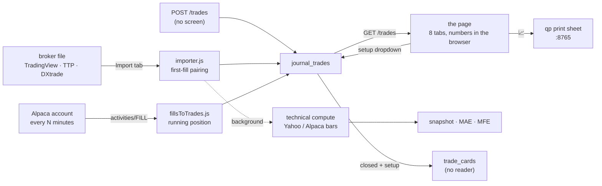

# The journal: every trade after the fact

The third program on the desk. Trades come in from broker files or straight
from Alpaca accounts. They are paired into round trips and measured: P&L, win
rate, drawdown, and results by hour, weekday, price, size and setup.

It stands on its own. It shares the desk's login, the app bar and the program
registry. Its one link out is the 📈 button, which opens qp's chart of the
trade. In a rebuild it becomes part of the web front
([REBUILD-ARCHITECTURE.md](../architecture/REBUILD-ARCHITECTURE.md)).

| | |
|---|---|
| Process | `journal` under pm2, `node journal/server.js`, port **3100** |
| Page | one page, eight tabs, all numbers computed in the browser |
| Its data | `data/journal/journal.db` (SQLite) and `journal-accounts.json` (Alpaca keys, mode 0600) |
| Ways in | file import (five detected formats), Alpaca accounts on a schedule, a hand-entry route |
| Calls out | Alpaca (fills; bars), Yahoo (bars) |
| Code | `journal/`: about 8,000 lines, 22 files |

---

## Where it stands

Read this before the details. The review behind these documents ran every
import format on a scratch database and measured what the analysis can
produce.

| Part | State |
|---|---|
| **Alpaca accounts** | **good.** The pairing is right (weighted prices, reversals split, stable ids) and tested. Two gaps: positions older than the look-back window (D-J11) and overnight trades (D-J12) |
| **The page and its numbers** | **good.** Clear formulas, filters that apply to every tab, a correct calendar. But R is empty everywhere, because no trade has a stop (D-J9) |
| **File imports** | **broken.** Scale-ins and scale-outs are mispaired, TradingView shorts are lost, the paper log fails, TTP orders and hand-closed DXtrade trades import nothing, and a second import duplicates everything (D-J1 to D-J7). No test covers it |
| **Technical snapshot** | **unreliable.** Wrong bar for morning trades half the year (D-J8); RVOL, ATR, pre-market and context are never filled; multi-day levels see after the entry (D-J13); computed for imports only, and shown nowhere |
| **Conditions and grading** | **inert.** Two condition systems; 55 of the 77 checks can never answer; a fresh database has no setups; no reader of the grading data (D-J13, D-J14) |
| **Chart button** | marks the trade 4 to 5 hours early (D-J10) |

---

## Read in this order

| # | Document | Answers |
|---|---|---|
| 1 | [PAGE.md](PAGE.md) | every tab, control and number on the page, with formulas |
| 2 | [ACCOUNTS.md](ACCOUNTS.md) | the Alpaca accounts: settings, keys, schedule, how fills become trades |
| 3 | [IMPORT.md](IMPORT.md) | the file formats, how fills are paired, hand entry, editing; what was tested |
| 4 | [ANALYSIS.md](ANALYSIS.md) | the technical snapshot, the two condition systems, the grading bridge, the check library, the grading engine |
| 5 | [DATA-MODEL.md](DATA-MODEL.md) | every file and table, who writes and reads it, the leftovers |
| 6 | [API.md](API.md) | every route, and whether anything calls it |
| 7 | [OPERATIONS.md](OPERATIONS.md) | the process, start-up, the timer, environment, the tests |
| 8 | [KNOWN-ISSUES.md](KNOWN-ISSUES.md) | open findings (D-J1 to D-J20), and what was fixed |

---

## How a trade moves through it

## The code, file by file (`journal/`)

| File | Lines | Does |
|---|---|---|
| `server.js` | 161 | the app: schema repair, login, routes, setup list, accounts, app bar |
| `src/db/index.js` | 146 | opens `journal.db`; also creates the old app's screener tables and settings |
| `src/journal/db.js` | 135 | the journal's own seven tables |
| `src/journal/importer.js` | 383 | file import: format detection, four parsers, pairing ([IMPORT.md](IMPORT.md)) |
| `src/routes/journal.js` | 407 | 19 routes under `/api/journal` ([API.md](API.md)) |
| `src/addons/accounts.js` | 327 | Alpaca accounts: the key store, the schedule, five routes ([ACCOUNTS.md](ACCOUNTS.md)) |
| `src/addons/fillsToTrades.js` | 174 | fills into round trips by running position |
| `src/journal/technicalFetch.js` | 338 | bars, the entry snapshot, MAE, MFE, R ([ANALYSIS.md](ANALYSIS.md)) |
| `src/journal/alignment.js` | 142 | the 18 template rules |
| `src/journal/bridgeToGrading.js` | 241 | copies closed, tagged trades into `trade_cards` and judges library checks |
| `src/journal/analysis.js` | 98 | the server's metrics and calendar |
| `src/trading/checks.js` | 1,934 | the check library: schema, 77 seeds, the condition evaluator |
| `src/trading/grading.js` | 738 | the grading tables; its functions have no caller |
| `src/trading/db.js` | 194 | the setup table, plus the removed live engine's tables and settings |
| `src/trading/dailyLevels.js` | 195 | multi-day levels (5-day MA, anchored VWAPs, highs and lows) |
| `src/trading/historicalCache.js` | 150 | a history cache for those levels; never filled in the journal |
| `src/trading/volumeBaseline.js` | 170 | the RVOL baseline; never built in the journal |
| `src/alpaca/client.js` | 240 | market-data bars and the key search; its account calls are unused |
| `src/yahoo/client.js` | 143 | used only by the history cache |
| `src/utils/time.js` | 24 | New York date and time helpers |
| `public/journal.html` | 1,080 | the page |
| `public/addons.js` | 558 | the app bar, accounts panel, setup filter, chart button, two-tap delete |

More than a third of the code (`checks.js`, `grading.js`, the trading
tables, the cache and baseline) came from the removed live trading engine and
does nothing the page shows.

---

## Rules a rebuild must keep

**Getting trades in**
1. **Pair fills by running position**, for every source: volume-weighted
   entry and exit, a reversal split into two trades, open positions kept as
   open trades. The Alpaca path already does this ([ACCOUNTS.md](ACCOUNTS.md#fills-into-trades)).
2. **A stable id from the source's own facts, including the account.**
   Fetching or importing again updates; it never duplicates.
3. **A trade the person has worked on is never overwritten** by a later fetch.
4. **Report what was not used**: unmatched fills, open positions, skipped rows.
5. **A sample file and tests for every format**, with shorts, scale-ins,
   scale-outs and partial closes.

**Keys**
6. **Broker keys stay on the box**: mode 0600, outside git and backups, never
   sent back to a page, used only for read calls.

**Time**
7. **Store real instants for entry and exit**, each with its own date. Show
   them in New York time. A trade's day is New York's.

**Numbers**
8. **One definition per number**, written down, computed in one place. Closed
   trades only, and a 0 trade defined once.
9. **Every trade has a stop**, so every trade has an R.
10. **Filters narrow one list that every view draws from.**

**Analysis**
11. **A snapshot is as of the entry minute**: no bar after the entry, history
    fetched for multi-day levels, the right time zone, and no "last bar"
    fallback.
12. **Only build what a screen shows.** Every route and table has a reader.

**Operations**
13. **A failed fetch is recorded with its reason** and waits for its turn.

## What not to copy

- the file importer's first-fill pairing, random ids and silent drops
  (D-J1 to D-J7);
- one `date` plus two clock times per trade (D-J12);
- New York clock times written as UTC and passed on as instants (D-J10);
- a fixed −05:00 offset for New York (D-J8);
- a snapshot that reads tables nothing writes, or bars after the entry (D-J13);
- two condition systems, and a grading engine with no input and no reader
  (D-J14, D-J16);
- the old app's tables and settings in the journal's database (D-J16);
- a fee setting that is stored but never applied (D-J15).
