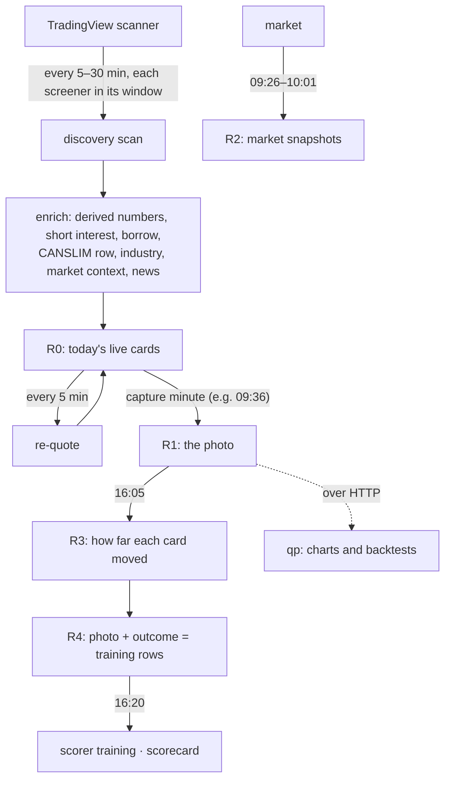

# The screener tools

The first program on the desk. Each **tool** watches the US market through
its own set of TradingView screeners, turns every match into a **card** with
everything known about the stock, freezes a **photo** of its cards once a day,
measures how far each card moved afterwards, and keeps all of it as that
tool's own history. The aim is to learn, with evidence, **which screeners
find stocks that move**.

Eleven tools are registered; five run today (T1, T2, T6, T7, T11). Stopped
tools stay readable.

---

## Complete stock card design

- [Interactive full-card prototype](card-design/index.html) — responsive card with all folds, badges, signal tags, score breakdown, shortlist and bias interactions. Values are illustrative.
- [Complete card specification](CARD-DESIGN-FULL.md) — field hierarchy, all eleven folds, data contracts, source/missing-value rules, color semantics and acceptance checklist.

## Read in this order

| # | Document | Answers |
|---|---|---|
| 1 | [METHODOLOGY.md](METHODOLOGY.md) | the research method, and what each tool hunts for and why |
| 2 | [PAGES.md](PAGES.md) | every screen: the suite page, the comparison, the eight tabs of a tool |
| 3 | [CARD.md](CARD.md) | the card, top to bottom, and its display rules |
| 4 | [CARD-FIELDS.md](CARD-FIELDS.md) | every field on a card, its source, and when a blank is legitimate |
| 5 | [DATA-PIPELINE.md](DATA-PIPELINE.md) | where every number comes from: each source and each processing stage |
| 6 | [REGISTERS.md](REGISTERS.md) | what is frozen each day (R0–R4, shortlist), every column |
| 7 | [MARKET-TAB.md](MARKET-TAB.md) | the Market tab: indexes, O'Neil model, regime, sectors, groups |
| 8 | [SCREENER-BUILDER.md](SCREENER-BUILDER.md) | how a screener is defined, checked, mirrored and sent to TradingView |
| 9 | [SETTINGS.md](SETTINGS.md) | every setting: default, accepted values, what reads it |
| 10 | [MONITOR.md](MONITOR.md) | every scheduled job and the Monitor tab |
| 11 | [DATACHECK.md](DATACHECK.md) | the data-source check: what makes a source ok, degraded or down |
| 12 | [TOOL-LIFECYCLE.md](TOOL-LIFECYCLE.md) | adding, starting, pausing, stopping, deleting tools |
| 13 | [DATA-MODEL.md](DATA-MODEL.md) | every table and file a tool keeps, and what survives a restart |
| 14 | [API.md](API.md) | every route a tool answers |
| 15 | [SCRIPTS.md](SCRIPTS.md) | the helper scripts and the question each answers |
| 16 | [SCORING-TODAY.md](SCORING-TODAY.md) | today's score and scorecard, and why not to copy them |
| 17 | [IDEAS.md](IDEAS.md) | the intent for the rebuilt score, builder and scorecard |
| 18 | [KNOWN-ISSUES.md](KNOWN-ISSUES.md) | every open finding, and what was fixed |

---

## A tool's day, in one picture

---

## Rules a rebuild must keep

Each comes from a failure or a decision recorded in these documents.

**The research method**
1. **One photo a day per tool**, at a minute when its screeners can have found
   something. Only the photo is training data ([METHODOLOGY.md](METHODOLOGY.md),
   [REGISTERS.md](REGISTERS.md)).
2. **Outcomes in ATR from fixed entry minutes** (A and B), the same good-move
   line everywhere (1.3 ATR) ([IDEAS.md](IDEAS.md)).
3. **Each tool is its own experiment**: its own screeners, registers,
   shortlist and model. Shared facts are labels, **never filters**
   ([DATA-PIPELINE.md](DATA-PIPELINE.md)).
4. **No look-ahead**: every stored value is what was known at that minute.
5. **Judge screeners by the move, not a trade**, with consistency across days
   deciding, against the tool's own baseline, the benchmark and the mirror
   ([SCORING-TODAY.md](SCORING-TODAY.md), [IDEAS.md](IDEAS.md)).

**The data**
6. **Missing is not zero, and not bearish.** A blank says why
   ([CARD-FIELDS.md](CARD-FIELDS.md)).
7. **One writer per shared fact**; when two sources exist, both are kept with
   a stated priority (the F-21 lesson, [KNOWN-ISSUES.md](KNOWN-ISSUES.md)).
8. **Check content, not "it answered"** ([DATACHECK.md](DATACHECK.md)).
9. **The tradability floor is one setting applied to every screener at scan
   time**, with named exceptions ([SCREENER-BUILDER.md](SCREENER-BUILDER.md)).

**The definitions**
10. **A screener's key never changes**; definitions should be **versioned**,
    so a frozen day records the rules that produced it.
11. **Times are checked against each other when saved** (capture vs windows,
    the D-S9 case).
12. **No code silently rewrites a definition** (the D-S10 lesson).

**Running it**
13. **Nothing important lives only in memory**: live cards, hot-sector state
    and job history survive a restart ([DATA-MODEL.md](DATA-MODEL.md)).
14. **Every scheduled job has a history and an alert when it fails or does
    not run** ([MONITOR.md](MONITOR.md)).
15. **Stopped tools stay fully readable**, scorecard included (the D-S14
    lesson) ([TOOL-LIFECYCLE.md](TOOL-LIFECYCLE.md)).

## What not to copy

- today's **score** and the **scorecard's up-only grading**
  ([SCORING-TODAY.md](SCORING-TODAY.md));
- settings that are accepted but never read, and help text that disagrees with
  the code ([SETTINGS.md](SETTINGS.md));
- the open items in [KNOWN-ISSUES.md](KNOWN-ISSUES.md).

---

## Elsewhere

qp (charts, strategies, backtests, the CANSLIM calculations behind the card's
O'Neil fold) is in [../qp/](../qp/README.md), the journal in
[../journal/](../journal/README.md), and how the programs connect today
(login, backups, deploy, shared files) in
[../architecture/ARCHITECTURE.md](../architecture/ARCHITECTURE.md). The new
design built on all of it is the [trunk](../../ARCHITECTURE.md).
