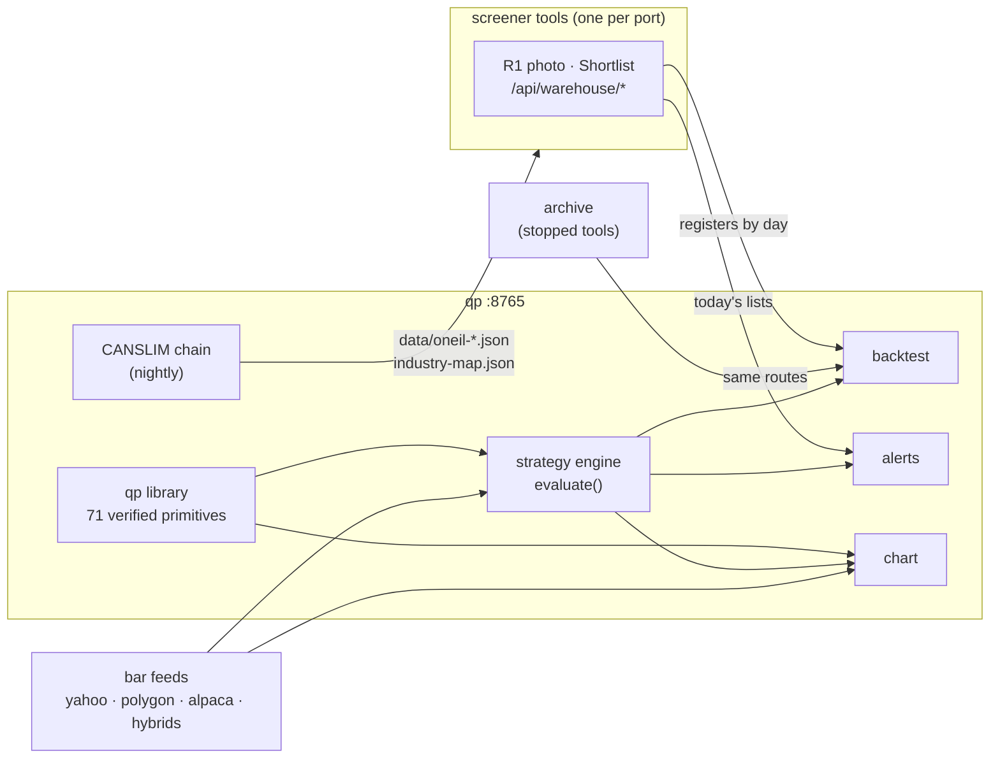

# qp: charts, strategies and backtests

The second program on the desk. It charts any stock with indicators that
have been verified against TradingView, lets you build trading rules by
clicking, backtests them on **the stocks the screener tools actually found,
on the days they found them**, watches today's lists for live signals, and
builds the O'Neil/CANSLIM data the screener cards and Market tab show.

| | |
|---|---|
| Process | `qp` under pm2, FastAPI (`quant-platform/chart/server.py`), port **8765** |
| Page | one page: chart, tools rail, strategy drawer, backtest, register browser, alerts, print sheets |
| Its data | `~/.qp/platform.db` (strategies, backtests), `~/.qp-cache/` (bars, CANSLIM caches) |
| Reads | the screener tools' registers, over HTTP |
| Writes for the tools | `data/oneil-*.json`, `data/industry-map.json` (the nightly chain) |

---

## Read in this order

| # | Document | Answers |
|---|---|---|
| 1 | [LIBRARY.md](LIBRARY.md) | the verified indicator library: the one rule, definition, verification, deviations from Pine |
| 2 | [CATALOG.md](CATALOG.md) | every primitive: inputs, outputs, parameters (generated) |
| 3 | [PAGE.md](PAGE.md) | everything on the page |
| 4 | [STRATEGIES.md](STRATEGIES.md) | the strategy grammar, how rules become trades, fill models, the exit plan and the order |
| 5 | [BACKTEST.md](BACKTEST.md) | the backtest: universe, honesty rules, every setting, accounting, the report |
| 6 | [DATA-FEEDS.md](DATA-FEEDS.md) | the bar feeds, warm-up, the cache and its limits, the borrow check |
| 7 | [ALERTS-AND-PRINTS.md](ALERTS-AND-PRINTS.md) | the live signal watcher and the print sheets |
| 8 | [CANSLIM.md](CANSLIM.md) | the O'Neil method as built: M, C, A, N, S, L, I, the RS rating, groups |
| 9 | [SCALPS.md](SCALPS.md), [SCALPS_SPEC.md](SCALPS_SPEC.md) | the five SMB scalps, and how each is built in the grammar |
| 10 | [PINE.md](PINE.md) | the three ready strategies as TradingView Pine scripts ([pine/](pine/)) |
| 11 | [OPERATIONS.md](OPERATIONS.md) | the process, restarts, the nightly CANSLIM job, environment |
| 12 | [DATA-MODEL.md](DATA-MODEL.md) | every table, file and cache, and what survives what |
| 13 | [API.md](API.md) | every route |
| 14 | [SCRIPTS.md](SCRIPTS.md) | the helper scripts and the test suite |
| 15 | [KNOWN-ISSUES.md](KNOWN-ISSUES.md) | open findings, and what was fixed |

The library's code is in [library/](library/README.md).

---

## How qp fits with the screener tools

## The code, file by file (`quant-platform/`)

| File | Does |
|---|---|
| `qp/registry.py`, `qp/primitives/*` | the library ([LIBRARY.md](LIBRARY.md)) |
| `chart/server.py` | the FastAPI app: every route, start-up |
| `chart/strategy.py` | the strategy engine: operands, rules, groups, trade pairing, fill models |
| `chart/exit_protocol.py` | the declared exit plan: legs, stops, runner |
| `chart/order_plan.py` | one function from a trade to broker orders: sizing, caps, legs, cents |
| `chart/backtest.py` | day-by-day replay, filters, ranking, accounting blocks |
| `chart/report.py` | the backtest report and statistics |
| `chart/rank_sweep.py` | which ranking metric suits a strategy |
| `chart/parity.py` | is the saved strategy the one a backtest ran |
| `chart/store.py` | the database: strategies, backtests, seeds, JSON copies |
| `chart/data_manager.py` | bars from the loaders, warm-up, the live tail |
| `chart/screener.py` | reading the tools' registers over HTTP, multi-source |
| `chart/alerts.py` | the live signal watcher |
| `chart/datacheck.py` | judging every source's data ([DATACHECK.md](../screeners/DATACHECK.md)) |
| `chart/oplog.py` | the operations log |
| `chart/auth.py` | the desk login, for qp and its WebSocket |
| `chart/oneil.py`, `relstrength.py`, `sic.py`, `groups.py`, `edgar.py`, `f13.py`, `base.py`, `ratings.py`, `canslim.py` | the CANSLIM chain ([CANSLIM.md](CANSLIM.md)) |
| `chart/static/index.html` | the page |
| `chart/seeds/*.json` | the bundled strategies |
| `tools/compare_server.py`, `tools/data/*` | the verification page and the bar loaders |
| `deploy/run_*.py`, `deploy/qp-*.service`, `qp-daily.timer` | the nightly chain and one-off jobs |

---

## Rules a rebuild must keep

**The math**
1. **One implementation of every indicator**, in one registry, used by the
   chart, the engine, the backtest and the alerts ([LIBRARY.md](LIBRARY.md)).
2. **Nothing is trusted until verified** against TradingView, with a recorded
   approval; the catalogue is generated, never hand-written.
3. **NaN means "not known yet"**, never zero; any missing operand makes a rule
   false.

**The strategy**
4. **One evaluator**: the preview, the backtest and live signals call the same
   function ([STRATEGIES.md](STRATEGIES.md)).
5. **The exit is declared**, leg by leg, every leg with its own stop, fractions
   summing to exactly 1.
6. **The order is one pure function**; the backtest books exactly those
   orders.

**The backtest**
7. **As of the day**, on the universe as frozen that day; only trades entered
   that day count ([BACKTEST.md](BACKTEST.md)).
8. **The honest fill by default** (decision at the close, fill at the next
   open, levels from the decision), explicit and never silently replaced.
9. **No trade before the scanner found the stock.**
10. **Costs, borrow and capital limits are modelled**, and everything excluded
    is counted and shown.
11. **A run keeps a frozen copy of what it ran**; numbers always state their
    basis (dollars or unit %) and their sample's adequacy.

**The data**
12. **A feed is judged by what it returns, not by whether a key exists**
    ([DATA-FEEDS.md](DATA-FEEDS.md)).
13. **Caches have limits tied to free disk.**
14. **qp is the only writer of the O'Neil files**, rebuilt every night by one
    job that never stops on one failed step ([OPERATIONS.md](OPERATIONS.md)).
15. **One supervisor**: pm2 only, never systemd as well.

## What not to copy

- the alerts' `close` fill, which differs from the backtest's (Q-N9);
- options the engine reports but does not simulate (`breakeven_after_target`,
  Q-N7);
- the text that still describes the removed trading module (Q-N3, Q-N10);
- the open items in [KNOWN-ISSUES.md](KNOWN-ISSUES.md).
